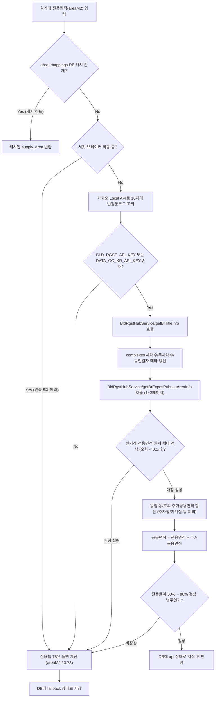

# 국토교통부 건축HUB 건축물대장 오픈 API 명세 및 연동 가이드

## 1. 개요 및 전환 배경 (2024.10 세움터 개편)

과거 국토교통부 건축데이터 민간개방 시스템(`open.eais.go.kr`) 및 공공데이터포털에서 제공되던 구형 건축물대장 API(`BldRgstService_v2`)가 서비스 종료됨에 따라, 건축행정정보시스템(세움터) 클라우드 재구축 기반의 **국토교통부_건축HUB_건축물대장정보 서비스(`BldRgstHubService`)**로 전면 전환되었습니다.

MyHome 플랫폼은 아파트 단지의 **공급면적(분양면적) 자동 계산**과 **단지 메타정보(총 세대수, 총 주차대수, 세대당 주차대수, 사용승인일)**를 실시간/배치로 보강하기 위해 건축HUB 오픈 API를 사용합니다.

- **서비스명**: 국토교통부_건축HUB_건축물대장정보 서비스
- **서비스 영문명**: `BldRgstHubService`
- **엔드포인트 (운영/개발 공통)**: `https://apis.data.go.kr/1613000/BldRgstHubService`
- **데이터 포맷**: XML (기본값) 및 JSON (`&_type=json` 파라미터 지원)
- **인증키 환경변수 정책**:
  - `BLD_RGST_API_KEY`: 건축HUB 전용 인증키 (선택)
  - `DATA_GO_KR_API_KEY`: 공공데이터포털 통합 인증키 (미입력 시 자동 폴백)

---

## 2. 핵심 제약사항 및 연동 주의점 (Critical Constraints)

개발 및 유지보수 시 반드시 준수해야 하는 API 제약사항입니다:

### 2.1 1회 요청 건수 제한 (`numOfRows <= 100`)
- **규격**: API 1회 요청 시 목록 수(`numOfRows`)는 **최대 100건으로 엄격히 제한**됩니다.
- **주의**: 과거 구형 API처럼 `numOfRows=1000` 등을 전달할 경우, 게이트웨이 파라미터 유효성 검사에서 즉시 **HTTP 400 Bad Request** 에러가 발생합니다.
- **페이징 처리**: 100건을 초과하는 데이터 검색이 필요할 경우, `pageNo`를 1부터 증가시키며 응답의 `<totalCount>`를 기반으로 반복 호출해야 합니다.

### 2.2 지번 및 코드 파라미터 규칙
- **시군구코드(`sigunguCd`)**: 법정동 10자리 코드 중 **앞 5자리** 행정표준코드 (예: 서울 강남구 `11680`, 마포구 `11440`).
- **법정동코드(`bjdongCd`)**: 법정동 10자리 코드 중 **뒤 5자리** (예: 개포동 `10300`, 아현동 `10100`).
- **대지구분코드(`platGbCd`)**:
  - `0`: 대지 (일반 아파트 단지 주소의 기본값이며, 생략 가능하나 `platGbCd=0` 명시 권장)
  - `1`: 산
  - `2`: 블록
- **본번(`bun`)과 부번(`ji`)**: 반드시 **4자리 Zero-Padding** 문자열로 전달해야 정상 매칭됩니다.
  - 예: 지번 `12` → `bun=0012&ji=0000`
  - 예: 지번 `123-45` → `bun=0123&ji=0045`

### 2.3 구형 API 대비 XML 응답 필드명 변경사항
| 대상 오퍼레이션 | 구형 API (`BldRgstService_v2`) | 신규 건축HUB (`BldRgstHubService`) | 비고 |
|---|---|---|---|
| **전유공용면적** | `exposPubuseAreaGbCd` | **`exposPubuseGbCd`** | 1: 전유, 2: 공용 |
| **전유공용구분명** | `exposPubuseAreaGbCdNm` | **`exposPubuseGbCdNm`** | "전유", "공용" |
| **사용승인일자** | `useAprvDay` | **`useAprDay`** | YYYYMMDD (8자리) |

> [!WARNING]
> 응답 필드명이 미세하게 변경(`v` 탈락, `Area` 탈락)되었으므로, 파싱 시 `target.useAprDay || target.useAprvDay`, `it.exposPubuseGbCd || it.exposPubuseAreaGbCd`와 같이 이중 폴백을 적용해야 데이터 누락이 없습니다.

---

## 3. MyHome 연동 주요 오퍼레이션 명세

### 3.1 건축물대장 표제부 조회 (`/getBrTitleInfo`)

단지의 메타데이터(총 세대수, 주차대수, 승인일 등)를 수집하여 DB `complexes` 테이블을 갱신할 때 사용합니다.

#### 요청 파라미터
```http
GET https://apis.data.go.kr/1613000/BldRgstHubService/getBrTitleInfo?serviceKey={API_KEY}&sigunguCd=11680&bjdongCd=10300&platGbCd=0&bun=0012&ji=0000&numOfRows=10&pageNo=1
```

| 파라미터명 | 구분 | 타입 | 설명 및 샘플 |
|---|---|---|---|
| `serviceKey` | 필수 | String | 공공데이터포털 일반 인증키 |
| `sigunguCd` | 필수 | String(5) | 행정표준 시군구코드 (`11680`) |
| `bjdongCd` | 필수 | String(5) | 법정동코드 (`10300`) |
| `platGbCd` | 옵션 | String(1) | 대지구분코드 (`0`: 대지) |
| `bun` | 옵션 | String(4) | 지번 본번 (`0012`) |
| `ji` | 옵션 | String(4) | 지번 부번 (`0000`) |
| `numOfRows` | 옵션 | Number | 목록 수 (최대 100, 기본 10) |
| `pageNo` | 옵션 | Number | 페이지 번호 (기본 1) |

#### 응답 주요 필드
| 태그명 | 설명 | 데이터 예시 | MyHome 활용처 |
|---|---|---|---|
| `<bldNm>` | 건물명 (단지명) | 대치아파트 303동 | 단지명 일치 검증 |
| `<dongNm>` | 동명칭 | 303동 | 건물 동 구분 |
| `<hhldCnt>` | **세대수(세대)** | `4199` | `complexes.total_households` |
| `<totPkngCnt>` | **총주차수(대)** | `4500` | `complexes.total_parking` |
| `<useAprDay>` | **사용승인일** | `20220813` | `complexes.use_approval_date` (`YYYY-MM-DD` 포맷팅) |
| `<grndFlrCnt>` | 지상층수 | `25` | 지상 층고 |
| `<ugrndFlrCnt>` | 지하층수 | `3` | 지하 층고 |
| `<strctCdNm>` | 구조코드명 | 철근콘크리트구조 | 건물 구조 정보 |

---

### 3.2 건축물대장 전유공용면적 조회 (`/getBrExposPubuseAreaInfo`)

실거래가 데이터의 **전용면적(`areaM2`)**을 기준으로 건축물대장 전유부를 검색하고, 해당 세대에 배속된 **주거공용면적을 합산하여 공급면적(분양면적)**을 산출합니다.

#### 요청 파라미터
```http
GET https://apis.data.go.kr/1613000/BldRgstHubService/getBrExposPubuseAreaInfo?serviceKey={API_KEY}&sigunguCd=11680&bjdongCd=10300&platGbCd=0&bun=0012&ji=0000&numOfRows=100&pageNo=1
```

| 파라미터명 | 구분 | 타입 | 설명 |
|---|---|---|---|
| `serviceKey` | 필수 | String | 공공데이터포털 일반 인증키 |
| `sigunguCd` | 필수 | String(5) | 행정표준 시군구코드 |
| `bjdongCd` | 필수 | String(5) | 법정동코드 |
| `platGbCd` | 옵션 | String(1) | 대지구분코드 (`0`: 대지) |
| `bun` / `ji` | 옵션 | String(4) | 4자리 제로패딩 지번 |
| `numOfRows` | 옵션 | Number | **최대 100건 준수** |
| `pageNo` | 옵션 | Number | 페이지 번호 (1부터 시작) |

#### 응답 주요 필드
| 태그명 | 설명 | 데이터 예시 | 면적 합산 처리 로직 |
|---|---|---|---|
| `<dongNm>` | 동명칭 | `302` | 세대 식별 키 (동) |
| `<hoNm>` | 호명칭 | `407호` | 세대 식별 키 (호) |
| `<exposPubuseGbCd>` | **전유/공용 구분코드** | `1` (전유) / `2` (공용) | `1`이면 실거래 전용면적과 대조 |
| `<exposPubuseGbCdNm>`| 전유/공용 구분코드명 | 전유 / 공용 | 보조 판별용 |
| `<area>` | **면적(㎡)** | `84.99` | 전유면적 또는 공용면적 실수값 |
| `<etcPurps>` | 기타용도 | 계단실, 복도, 주차장 등 | **기타공용/주차장 제외 필터링** |

---

## 4. MyHome 시스템 내부 처리 로직 (`areaMapper.ts`)

MyHome의 분양면적 계산 엔진인 [`packages/shared/src/areaMapper.ts`](file:///e:/apps/myhome/packages/shared/src/areaMapper.ts)의 상세 동작 흐름은 다음과 같습니다:



### 4.1 주거공용면적 선별 필터링
아파트 공급면적은 **전용면적 + 주거공용면적(계단, 복도, 현관 등)**으로 구성됩니다. 지하주차장, 관리사무소, 노유자시설 등 **기타공용면적은 법정 분양면적에서 제외**되어야 하므로 아래 키워드가 포함된 공용 항목은 합산에서 제외합니다:
```typescript
const excludeKeywords = ["주차", "기계", "전기", "정화조", "발전", "기타", "노유자", "주민"];
const isExcluded = excludeKeywords.some((kw) => purpose.includes(kw));
```

### 4.2 페이징 안전 가드 (최대 300건 탐색)
세대수가 많은 대단지 아파트의 경우 첫 100건에 실거래 면적 타입이 나타나지 않을 수 있습니다. 따라서 최대 3페이지(300건)까지 점진적으로 순회하여 매칭 성공 시 즉시 루프를 탈출하도록 최적화되어 있습니다:
```typescript
for (let page = 1; page <= 3; page++) {
  const url = `https://apis.data.go.kr/1613000/BldRgstHubService/getBrExposPubuseAreaInfo?serviceKey=${apiKey}&sigunguCd=${sigunguCd}&bjdongCd=${bjdongCd}&platGbCd=0&bun=${bun}&ji=${ji}&numOfRows=100&pageNo=${page}`;
  // ...
  if (matchedExpos.length > 0) break;
}
```

### 4.3 서킷 브레이커 (Circuit Breaker)
공공데이터포털 서버 장애나 인증키 트래픽 초과로 에러가 연속 5회 발생하면 서킷 브레이커가 동작하여 **15분 동안 외부 API 호출을 전면 차단**하고 즉시 78% 전용률 폴백으로 처리하여 서버 응답 지연을 방지합니다.

---

## 5. 건축HUB 기타 오퍼레이션 목록 (향후 확장용)

| 번호 | 오퍼레이션명 (영문) | 오퍼레이션명 (국문) | 용도 |
|---|---|---|---|
| 1 | `getBrBasisOulnInfo` | 건축물대장 기본개요 조회 | 대장종류, 대장구분, 새주소, 지역/지구/구역 등 |
| 2 | `getBrRecapTitleInfo`| 건축물대장 총괄표제부 조회 | 단지 전체 대지면적, 연면적, 건폐율, 용적률 |
| 3 | `getBrTitleInfo` | 건축물대장 표제부 조회 | 동별 대지면적, 세대수, 주차대수, 승인일 (**현재 연동**) |
| 4 | `getBrFlrOulnInfo` | 건축물대장 층별개요 조회 | 층별 구조, 용도, 면적 |
| 5 | `getBrAtchJibunInfo` | 건축물대장 부속지번 조회 | 부속지번 주소 및 대장구분 |
| 6 | `getBrExposPubuseAreaInfo` | 건축물대장 전유공용면적 조회 | 전유/공용면적 층, 구조, 용도, 면적 (**현재 연동**) |
| 7 | `getBrWclfInfo` | 건축물대장 오수정화시설 조회 | 오수정화 형식, 용량 |
| 8 | `getBrHsprcInfo` | 건축물대장 주택가격 조회 | 공시가격 (주택가격 기준일자 및 가격) |
| 9 | `getBrExposInfo` | 건축물대장 전유부 조회 | 전유부 동/호 명칭 기본 정보 |
| 10 | `getBrJijiguInfo` | 건축물대장 지역지구구역 조회 | 용도지역(일반주거 등), 지구단위계획구역 등 |

---

## 6. 구 PK vs 신규 건축HUB PK 변환 참고사항

건축데이터 민간개방 시스템(`open.eais.go.kr`)의 과거 데이터 덤프를 마이그레이션할 경우 신규 PK(`mgmBldrgstPk`)와의 연동 규칙은 다음과 같습니다:

- **신규 건축HUB PK 형태**: 22자리 단일 일련번호 (별도 가공 없음)
- **과거 PK 형태**: `시도·시군구코드` + `-` + `일련번호`
  - 유형 1 (일련번호가 22자리): `시도·시군구코드`와 `-`를 제거하면 신규 PK와 100% 동일
  - 유형 2 (일련번호가 22자리 미만): `통합분류코드(4자리) + 대장구분(1자리: 0=폐말소, 1=실대장) + 일련번호` 형태로 매핑
- **주의**: REST OpenAPI 호출 시에는 통합분류코드가 아닌 **표준 5자리 시군구코드(`sigunguCd`)**를 요청 인자로 사용해야 합니다.
