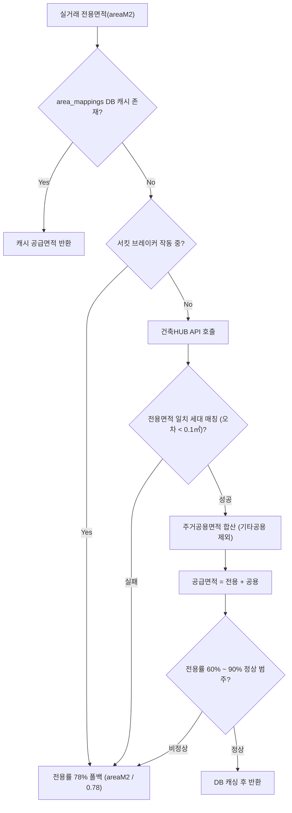

# [10] 건축HUB 건축물대장 API 명세 및 연동 가이드

국토교통부 건축HUB(`BldRgstHubService`) 오픈 API 연동 규격. 단지 메타데이터(세대수/주차/승인일) 및 공급면적(분양면적) 산출 목적.

## 1. 개요 및 엔드포인트

- **서비스명**: 국토교통부_건축HUB_건축물대장정보 서비스 (`BldRgstHubService`)
- **엔드포인트**: `https://apis.data.go.kr/1613000/BldRgstHubService`
- **인증키 환경변수**: `BLD_RGST_API_KEY` (우선) ➔ `DATA_GO_KR_API_KEY` (폴백)
- **포맷**: XML (기본값) 및 JSON (`&_type=json`)

## 2. 필수 제약사항 (Critical Constraints)

- **1회 요청 건수 제한**: `numOfRows <= 100` 엄격 제한 (`> 100` 시 HTTP 400 발생). 100건 초과 시 `pageNo` 증가 반복 호출.
- **지번 및 행정코드 규칙**:
  - `sigunguCd`: 시군구 5자리 (예: `11680`)
  - `bjdongCd`: 법정동 뒤 5자리 (예: `10300`)
  - `platGbCd`: 대지구분 (`0`: 대지)
  - `bun`, `ji`: 4자리 Zero-Padding 필수 (예: `bun=0012&ji=0000`)
- **XML 응답 필드 변경 이중 폴백**:
  - 전유공용구분: `it.exposPubuseGbCd || it.exposPubuseAreaGbCd`
  - 사용승인일: `target.useAprDay || target.useAprvDay`

## 3. 주요 오퍼레이션 명세

### 3.1 표제부 조회 (`/getBrTitleInfo`)
- **목적**: `complexes` 테이블 단지 메타데이터 갱신 (세대수, 주차대수, 승인일자).
- **요청 파라미터**: `sigunguCd`, `bjdongCd`, `platGbCd=0`, `bun`, `ji`, `numOfRows=10`, `pageNo=1`
- **핵심 응답 태그**:
  - `<hhldCnt>`: 세대수 (`complexes.total_households`)
  - `<totPkngCnt>`: 총주차수 (`complexes.total_parking`)
  - `<useAprDay>`: 사용승인일 (YYYYMMDD ➔ `complexes.use_approval_date`)

### 3.2 전유공용면적 조회 (`/getBrExposPubuseAreaInfo`)
- **목적**: 실거래 전용면적(`areaM2`) 기준 주거공용면적 합산 ➔ 공급면적 산출.
- **요청 파라미터**: `sigunguCd`, `bjdongCd`, `platGbCd=0`, `bun`, `ji`, `numOfRows=100`, `pageNo=1`
- **핵심 응답 태그**:
  - `<dongNm>`, `<hoNm>`: 세대 식별
  - `<exposPubuseGbCd>`: `1` (전유) / `2` (공용)
  - `<area>`: 면적(㎡)
  - `<etcPurps>`: 용도 (기타공용/주차장 선별 제외용)

## 4. 내부 면적 계산 로직 (`areaMapper.ts`)

- **주거공용 선별 필터**:
  `const excludeKeywords = ["주차", "기계", "전기", "정화조", "발전", "기타", "노유자", "주민"];` 제외.
- **페이징 가드**: 최대 3페이지(300건)까지 점진적 순회 후 조기 종료.
- **서킷 브레이커**: 연속 5회 오류 시 15분간 외부 호출 차단, 전용률 78% 즉시 폴백.
