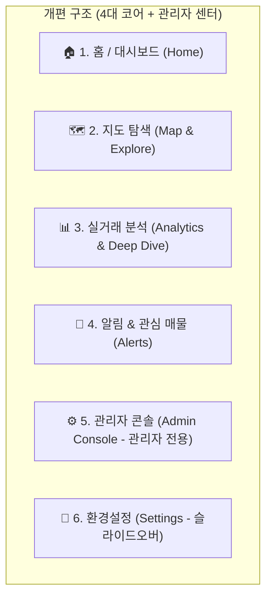
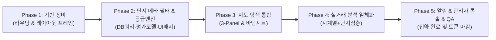

# [Plan 12] 프론트엔드 전면 디자인 개편 및 단지 메타/등급 평가 고도화 마스터 플랜

> **문서 번호**: Plan 12  
> **작성일**: 2026-10-25  
> **대상**: `@myhome/dashboard` (React 19 + TypeScript + Vite + Tailwind CSS + Recharts + Kakao Maps) 및 백엔드/DB/인프라 평가 엔진  
> **관련 문서**: [01_OVERVIEW.md](../01_OVERVIEW.md), [05_DESIGN.md](../05_DESIGN.md), [10_BUILDING_REGISTER_API.md](../10_BUILDING_REGISTER_API.md), [11_UI_UX_UNIFICATION_PLAN.md](./11_UI_UX_UNIFICATION_PLAN.md)  
> **목표**: 
> 1. 11개로 분산되고 산만한 UI/UX를 **사용자 여정 중심 4대 핵심 축 + 관리자 콘솔**로 전면 재편.
> 2. 모바일(390px)과 PC(>=1280px) 전용 반응형 레이아웃 확립.
> 3. **건축물대장 4대 메타정보(세대수, 주차대수, 세대당 주차대수, 준공연도)** 검색 필터화 및 단지 UI 시각화 강화.
> 4. **단지 등급 평가 모델에 "세대당 주차대수"를 평가 카테고리로 공식 편입**하여 종합 주거가치 점수 정밀도 제고.

---

## 1. 개편 배경 및 문제 진단 (AS-IS)

### 1.1 현황 진단: 왜 지금 UI가 산만한가?

| 구분 | 주요 문제점 | 실측 및 원인 | 사용자 체감 영향 |
|---|---|---|---|
| **정보 구조 (IA)** | 11개 뷰의 수평적 나열 | `dashboard`, `analytics`, `regionMap`, `complexAnalysis`, `nearby`, `rules`, `collect`, `activityLog`, `dbAdmin`, `allowedAccounts`, `settings`가 단일 계층에 병렬 배치 | 내가 찾는 기능이 어디 있는지 파악 불가, 관리 기능과 탐색 기능이 혼재 |
| **기능 및 화면 중복** | 지도·수집·필터의 다중 파편화 | • 지도가 3곳에 존재 (`Dashboard` 1205줄 내 미니맵, `RegionMapPage` 1360줄, `NearbyStationTab` 1241줄)<br>• 수집 UI가 2곳에 중복 (`Dashboard` 모달, `Collect` 페이지)<br>• 필터 UI가 제각각 (`FilterPanel` 1184줄, 맵 상단 툴바, 아코디언 등) | 같은 데이터/작업인데 페이지마다 입력 방식과 시각 톤이 다름 |
| **단지 메타정보 활용 미흡** | 건축물대장 핵심 정보의 검색 조건 부재 | DB(`complexes`)에 세대수, 주차대수, 승인일이 적재되어 있음에도 검색 조건은 지역/기간/면적에 국한됨 | 대단지(1000세대+), 주차 여유 단지(1.3대+), 신축/구축 필터링 불가 |
| **입지/단지 등급 평가의 편향** | 주차 쾌적도 미반영 | 현행 `geocoding-infra.ts`는 외부 시설(지하철, 학교, 병원, 마트)만 평가하고, 실거주 핵심인 **단지 자체 주차 여건**이 제외됨 | 실제 주차난이 심각한 단지도 입지 점수만으로 고등급(S/A)을 받는 왜곡 발생 |
| **모바일 UX 결함** | 좁은 화면의 과밀화 및 네비게이션 단절 | 하단 네비 5개 제한으로 핵심 기능(`단지 분석`, `역세권`)이 "전체 메뉴 드로어"에 숨겨짐. 1,000줄 이상의 거대 페이지들이 세로로 길게 늘어섬 | 한 손 조작 불가, 중요한 차트/지도 인터랙션이 잘리거나 터치 오류 발생 |
| **PC 레이아웃 미활용** | 와이드 스크린 방치 | 좌측 사이드바 외에 우측 1280px+ 영역을 단순 단일 열(Single Column)로 스택 배치하여 여백 낭비 및 시선 분산 | 대형 모니터에서도 화면을 아래로 한참 내려야 전체 정보를 볼 수 있음 |

---

## 2. 개편 방향 및 핵심 원칙 (TO-BE)

### 2.1 4대 디자인 원칙
1. **단순화 & 통합 (Simplify & Consolidate)**: 유사한 기능과 중복 화면을 1개의 완성도 높은 워크스페이스로 통폐합한다.
2. **목적 중심 내비게이션 (Purpose-Driven Navigation)**: 11개 메뉴를 **[홈] [지도 탐색] [실거래 분석] [알림]** 4개 사용자 메뉴와 **[관리자 센터]**로 압축한다.
3. **디바이스 맞춤형 레이아웃 (Device-Optimized Ergonomics)**:
   - **모바일 (390px)**: 하단 탭바 + 상단 플로팅 검색 + 풀스크린 맵 & 제스처 바텀시트 + 1컬럼 스와이프 카드.
   - **PC (>= 1280px)**: 3-Panel 워크스페이스 (좌측 필터/목록 + 중앙 맵/차트 + 우측 인스펙터 패널)로 화면 공간 극대화.
4. **실거주 가치 중심의 다차원 분석 (Living Value Analytics)**: 건축물대장 4대 메타(세대수·주차대수·세대당 주차·준공연도)를 검색과 평가의 핵심 축으로 격상.

---

## 3. 건축물대장 메타 확장 및 단지 등급 평가 고도화

### 3.1 검색 조건(Filter) 확장 규격

기존의 지역/기간/면적/금액 중심 필터에 **단지 스펙 4종 필터**를 통합합니다.

```typescript
// @myhome/shared types.ts 확장 규격
export interface ComplexMetaFilter {
  /** 최소 세대수 (예: 300, 500, 1000세대 이상) */
  minHouseholds?: number;
  /** 최소 총 주차대수 (예: 500, 1000대 이상) */
  minTotalParking?: number;
  /** 최소 세대당 주차대수 (예: 1.0, 1.2, 1.5대 이상) */
  minParkingPerHousehold?: number;
  /** 준공연도 범위 (시작 연도, 예: 2015) */
  minBuildYear?: number;
  /** 준공연도 범위 (종료 연도, 예: 2026) */
  maxBuildYear?: number;
  /** 신축/연차 프리셋 (all | under5 | under10 | under15 | over20) */
  buildingAgePreset?: "all" | "under5" | "under10" | "under15" | "over20";
}
```

#### 필터 UI 컴포넌트 (`ComplexMetaFilterBar`)
- **세대수 칩**: `[전체]` `[300세대+]` `[500세대+]` `[1,000세대+ (대단지)]`
- **세대당 주차 칩**: `[전체]` `[1.0대+]` `[1.2대+ (여유)]` `[1.5대+ (광폭)]`
- **연차/준공연도 슬라이더 및 프리셋**: `[신축(5년이내)]` `[준신축(10년이내)]` `[구축(15년이상)]` `[재건축대상(30년이상)]`

---

### 3.2 아파트 단지 정보 표시(UI Card & Inspector) 강화

지도 마커 팝업, 좌측 검색 리스트, 우측 인스펙터 패널, 단지 상세 헤더에 **단지 메타 배지 바(Meta Badge Bar)**를 일관되게 렌더링합니다.

#### 단지 카드 표시 규격
```
+-------------------------------------------------------------+
| 🏢 은마아파트                          [★ 관심] [A등급 84점] |
| 서울특별시 강남구 대치동 316 (1979년 준공 · 48년차)           |
+-------------------------------------------------------------+
| [👥 4,424세대]  [🚗 4,500대]  [🅿️ 세대당 1.02대]  [🏗️ 용적률 -] |
+-------------------------------------------------------------+
| 최근 실거래: 27.5억 (2026.10.15, 84㎡, 11층)                  |
| 1년 변동: ▲ 2.1억 (+8.3%) | 최고 28.2억 / 최저 24.5억        |
+-------------------------------------------------------------+
```

1. **연차 계산 뱃지**: `useApprovalDate`를 바탕으로 `YYYY년 준공 (N년차)` 자동 환산 표기. (5년 이내는 초록색 `신축`, 30년 이상은 주황색 `구축/재건축` 배지 부여)
2. **주차 여유도 시각화**:
   - `parkingPerHousehold >= 1.5`: 🟢 초록 뱃지 (`세대당 1.52대 · 여유`)
   - `1.1 <= parkingPerHousehold < 1.5`: 🔵 파랑 뱃지 (`세대당 1.25대 · 양호`)
   - `0.9 <= parkingPerHousehold < 1.1`: 🟡 노랑 뱃지 (`세대당 0.98대 · 보통`)
   - `parkingPerHousehold < 0.9`: 🔴 빨강 뱃지 (`세대당 0.65대 · 주차혼잡`)

---

### 3.3 단지 종합 등급 평가에 "세대당 주차대수" 산입

#### 평가 체계 개선안 (`geocoding-infra.ts`)
기존 4대 인프라(역세권, 학교, 병원, 마트)에 **단지 주차 쾌적도(`PKG`)를 5대 핵심 지표로 공식 편입**합니다.

| 카테고리 코드 | 지표명 | 가중치(Weight) | 평가 기준 |
|---|---|:---:|---|
| **SW8** | 역세권 (지하철) | 1.5 | 도보 250m 이내(100점), 500m(85점), 1000m(60점) |
| **SC4** | 학군 (초/중/고) | 1.2 | 도보 150m 이내(100점), 300m(85점), 500m(60점) |
| **PKG (신규)** | **주차 쾌적도** | **1.2** | **세대당 1.5대 이상 (100점)**<br>• 1.3대 ~ 1.5대 미만 (85점)<br>• 1.1대 ~ 1.3대 미만 (70점)<br>• 0.9대 ~ 1.1대 미만 (50점)<br>• 0.9대 미만 (30점)<br>*(미등록 단지는 70점 중위값 부여)* |
| **HP8** | 의료 (병원/약국) | 0.8 | 300m 이내 종합병원(100점), 병의원 밀집도 |
| **MT1** | 상권 (대형마트) | 0.7 | 500m 이내 대형마트(100점), SSM/편의점 |
| **NAT** | 조망/환경 (가산점) | +보너스 | 한강/바다/하천/호수/대형공원 (최대 +10점 가산) |

#### 종합 점수 및 등급 산출 공식
$$\text{BaseScore} = \frac{\sum (\text{카테고리점수} \times \text{가중치})}{\sum \text{가중치}} \quad (\text{가중치합} = 1.5 + 1.2 + 1.2 + 0.8 + 0.7 = 5.4)$$

$$\text{TotalScore} = \min(100, \text{BaseScore} + \text{NAT 가산점})$$

- **S등급**: 90점 이상 (특급 입지 & 쾌적 주차 단지)
- **A등급**: 80점 ~ 89점 (우수 주거 단지)
- **B등급**: 70점 ~ 79점 (표준 주거 단지)
- **C등급**: 60점 ~ 69점 (일부 인프라/주차 보완 필요 단지)
- **D등급**: 60점 미만 (인프라 취약 단지)

---

## 4. 정보 구조(IA) 및 화면 재구성안



| 신규 메뉴 | 포함/통합되는 기존 뷰 | 주요 기능 및 화면 역할 |
|---|---|---|
| **1. 홈 (Home)** | • `Dashboard` (모니터링 기능 정제)<br>• 실시간 거래 피드<br>• 알림 요약 | • **시장 요약 KPI**: 최근 거래량, 최고/최저가 변동 브리핑<br>• **내 관심 단지 퀵뷰**: 즐겨찾기 단지 시세 및 스펙 배지<br>• **실시간 실거래 속보**: 국토부 최신 수집 데이터 피드 |
| **2. 지도 탐색 (Map & Explore)** | • `RegionMapPage` (기본 지도)<br>• `NearbyStationTab` (지하철역 레이어)<br>• 메타 필터 (세대/주차/연식) | • **풀 인터랙티브 맵**: 카카오맵 기반 전국 단지 핀 클러스터링 및 사분위 색상 마커<br>• **단지 스펙 다차원 필터**: 세대수/주차대수/준공연도/역세권 반경 슬롯<br>• **인스펙터 (Inspector)**: 핀 클릭 시 즉시 우측(PC) / 바텀시트(모바일)에 단지 실거래가 및 건축물대장 요약 노출 → 원클릭 '심층 분석' 연계 |
| **3. 실거래 분석 (Analytics)** | • `GraphDashboard` (종합 통계/시계열)<br>• `ComplexAnalysisPage` (단지 상세)<br>• `InsightTab` (AI 인사이트) | • **통합 상단 탭**: `[지역 시계열 분석]` ↔ `[단지 심층 분석]` ↔ `[AI 인사이트]`<br>• **원활한 드릴다운**: 종합 현황에서 특정 단지 클릭 시 부드럽게 단지 탭으로 전환되며 브레드크럼 유지<br>• **건축물대장 + 실거래 시계열**: 표제부/전유부/층별현황 및 평형별 거래 분포 일체화 |
| **4. 알림 & 관심 매물 (Alerts)** | • `Rules` (감시 룰 설정/관리)<br>• `Dashboard` 알림 히스토리 | • **스마트 알림 룰 설정**: 지역/단지/금액/면적 + 세대수 조건 기반 텔레그램 실시간 알림 등록<br>• **포착 매물 타임라인**: 최근 감지되어 발송된 매물 카드 목록 |
| **5. 관리자 센터 (Admin)**<br>*(관리자 전용)* | • `Collect` (데이터 수집)<br>• `DatabaseAdmin` (DB 관리)<br>• `AllowedAccounts` (계정 승인)<br>• `ActivityLog` (감사 로그) | • **서브 탭/스위처 일원화**: 단일 '관리자 콘솔' 뷰 내에서 `[데이터 수집]` `[DB 관리자]` `[활동 로그]` `[계정 관리]` 탭으로 전환<br>• 일반 사용자 화면에서 관리자 잡음을 완전히 제거 |
| **6. 환경 설정 (Settings)** | • `Settings`<br>• 테마/폰트/프로필 설정 | • 독립 페이지 대신 우측 상단/사이드바 프로필 클릭 시 열리는 **슬라이드오버(Side Drawer)**로 제공 |

---

## 5. 디바이스별 화면 레이아웃 설계

### 5.1 PC 데스크톱 (Desktop: >= 1280px)

#### [지도 탐색] 3-Panel 워크스페이스
```
+---------------------------------------------------------------------------------------------------+
| [사이드바] | [좌측 패널: 380px]          | [중앙 패널: 가변 맵]               | [우측 인스펙터: 420px]           |
|  w-16/56   |                             |                                  |                                |
|            | • 통합 지역/단지 검색바     | • 카카오 지도 풀 뷰포트          | [X 닫기] [★ 관심단지]           |
| • 홈       | --------------------------- | • 사분위 가격 색상 마커           | 🏢 은마아파트 [A등급 84점]       |
| • 지도(★)  | [스펙 필터 접기/펼치기]     | • 클러스터링 및 지도 컨트롤      | 강남구 대치동 (1979년 · 48년차) |
| • 분석     | • 세대수: [500세대+] [1000+]|                                  | ------------------------------ |
| • 알림     | • 세대당주차: [1.2대+]      | • 줌 인/아웃, 위치 재설정        | [👥 4,424세대] [🅿️ 세대당 1.02대]|
|            | • 준공연차: [신축] [구축]   | • 상단 플로팅 지도 범례(Legend)   | ------------------------------ |
| [관리자]   | --------------------------- |                                  | • 최근 실거래: 27.5억 (▲1.2억) |
| [설정]     | • 검색된 단지 리스트        |                                  | • 평형별 시세 미니 차트        |
|            |   (총 18개 단지 일치)       |                                  | • 입지/주차 평가 상세 레이더차트|
|            |   - 은마 (4,424세대/1.02대) |                                  | • [👉 단지 심층 분석으로]      |
+---------------------------------------------------------------------------------------------------+
```

---

### 5.2 모바일 (Mobile: 390px ~ 430px)

#### [지도 탐색] 모바일 풀스크린 맵 & 제스처 바텀시트
```
+-----------------------------+
| [TopBar] 🔍 대치동 [필터(3)] |  <- 상단 플로팅 검색/스펙필터 버튼
+-----------------------------+
|                             |
|      카카오 맵 풀 뷰포트      |  <- 전체 화면 지도
|      (마커 탭 시 시트 확장)   |
|                             |
|    [ 📍내위치 ]  [ 범례 ]    |
+-----------------------------+
| === [ 핸들바 (Drag Handle) ]===|  <- 인터랙티브 바텀시트
| 🏢 은마아파트       [A등급 84점]|     • 1단계(접힘 120px): 단지명 + 27.5억 + [4424세대/1.02대]
| 27.5억 | 👥 4,424세대 · 🅿️ 1.02대|     • 2단계(절반 50%): 시세 변동 + 건축물대장 요약 + 평형별 시세
| --------------------------- |     • 3단계(전체 90%): 실거래 내역 리스트 + 입지평가 세부항목
| [👉 단지 심층 분석 바로가기]   |
+-----------------------------+
| [홈]  [★지도]  [분석]  [알림]  [더보기]|  <- 하단 탭바 (Sticky)
+-----------------------------+
```

---

## 6. 단계별 실행 계획 (Phase별 로드맵)



### Phase 1: 라우팅 체계 및 셸(Shell) 레이아웃 재편
- **내용**: 11개 뷰 → 5대 코어 뷰 리팩터링, PC 사이드바 & 모바일 5탭 바텀네비 전환, `AdminPage` 셸 생성.

### Phase 2: 건축물대장 메타 필터링 & 단지 등급 평가 엔진 고도화
- **내용**:
  1. `packages/shared/src/types.ts`: `ComplexMetaFilter` 필드 추가.
  2. `packages/shared/src/db/regions.ts`: `getRegionComplexesMapData`에 세대수/주차대수/준공연도 필터 조건(SARGable SQL) 추가.
  3. `packages/dashboard/server/geocoding-infra.ts`:
     - 세대당 주차대수(`PKG`, 가중치 1.2) 평가 로직 신설 및 `totalScore`/`grade` 반영.
     - Mock 생성기 및 실측 평가기에 주차 평점 공식 적용.
  4. 단지 카드/인스펙터용 공통 `ComplexMetaBadges` 컴포넌트 구현 (세대수, 주차대수, 세대당 주차, 준공연차).

### Phase 3: [지도 탐색] 워크스페이스 통합 구축
- **내용**:
  1. `RegionMapPage`에 역세권 오버레이 및 신규 스펙 필터 바 통합.
  2. PC 3-Panel(필터/목록 + 풀맵 + 인스펙터) 및 모바일 3단 스냅 바텀시트 완성.
  3. `Dashboard.tsx`의 중복 미니맵 제거.

### Phase 4: [실거래 분석] 종합 현황 & 단지 분석 일체화
- **내용**: `GraphDashboard` + `ComplexAnalysisPage` 통합, 상단 Sticky 필터바 및 드릴다운 브레드크럼 연결.

### Phase 5: [알림] & [관리자 콘솔] 통합 및 비주얼 폴리싱
- **내용**: 알림 규칙/히스토리 탭 일원화, 수집/DB/계정/로그를 단일 관리자 콘솔로 통합, 390px/768px/1440px 크로스 브라우징 및 빌드 검증.
