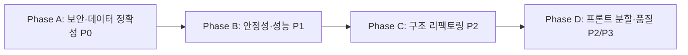

# [13] 코드 리뷰 기반 리팩토링 · 개선 · 튜닝 개발계획

> **대상 버전**: v0.3.5 이후 / **작성일**: 2026-10-29
> **목적**: 코드 검토에서 확인된 보안·안정성·성능·구조 이슈를 우선순위별 작업(Task)으로 분해. **Gemini(개발 에이전트)가 Task 단위로 독립 수행**할 수 있게 정리.
> **검토 범위**: `packages/shared`, `packages/collector`, `packages/dashboard`(server + src), Dockerfile, 빌드/테스트 구성.

---

## 0. Gemini 작업 지침 (필독)

1. 작업 전 `AGENTS.md` → `docs/01_OVERVIEW.md` → 해당 Task의 "관련 문서" 순으로 읽는다.
2. **Task 1개 = 1개 커밋 단위**. 한 번에 여러 Task를 섞지 않는다 (Small, incremental).
3. 사용자 노출 문자열은 반드시 i18n(`src/locales/ko.ts` + en) 처리. 서버 에러 메시지도 신규 추가분은 코드(`code`)+메시지 구조 권장.
4. 프론트 변경 시 390px / 태블릿 / 데스크톱 3개 뷰포트 검증.
5. DB 변경은 `packages/shared/src/db/` 도메인 모듈에만 추가, `db.ts`는 re-export 배럴 유지. SQL은 SARGable, N+1 지양.
6. 서버 라우트 로직은 `server/routes/` 하위 도메인 라우터에 배치. `routes.ts`에 로직 누적 금지.
7. 각 Task 완료 시 **공통 검증**을 수행한다:
   ```powershell
   npm run build
   npm run typecheck --workspace=packages/dashboard
   npm test --workspace=packages/dashboard
   ```
8. Task 완료 후 이 문서의 체크박스를 `[x]`로 갱신하고, 영향받는 `docs/0X_*.md`를 함께 수정한다.
9. 모호한 요구는 임의 해석하지 말고 사용자에게 확인한다.

### 우선순위 정의
| 등급 | 의미 |
|---|---|
| **P0** | 보안/데이터 정확성 결함 — 즉시 수정 |
| **P1** | 안정성·성능 — 다음 스프린트 |
| **P2** | 구조 개선·유지보수성 |
| **P3** | 품질·문서·편의 |

---

## 1. 검토 결과 요약

### 1.1 현황
| 항목 | 상태 |
|---|---|
| 타입체크 (`dashboard`) | 통과 |
| 단위 테스트 | 서버 4개 파일만 존재(`mcpThrottle`, `validation`, `storage`, `ruleEngine`). **shared/collector/프론트 0건**, 인증·수집·SQL 테스트 부재 |
| 거대 파일 | `ComplexTab.tsx` 1,940줄, `OverviewTab.tsx` 1,409줄, `DatabaseAdmin.tsx` 1,326줄, `FilterPanel.tsx` 1,262줄, `NearbyStationTab.tsx` 1,244줄, `RegionMapPage.tsx` 1,168줄, `ko.ts` 1,063줄, `geocoding-infra.ts` 779줄 |
| `any` 사용 | 서버/공유 계층 다수 (`index.ts`, `geocoding-infra.ts`, `analytics.ts`, `rules.ts` …) |

### 1.2 이슈 목록 (ID 기준)

| ID | 등급 | 분류 | 요약 | 위치 |
|---|---|---|---|---|
| S-1 | P0 | 보안 | 로그인(`/auth/login-local`)에 브루트포스 방어 없음 (rate-limit은 `routes.ts` 일반 API에만 적용, `/api/auth`는 그 앞에 마운트) | `server/index.ts`, `authRoutes.ts` |
| S-2 | P0 | 보안 | OAuth `state` 파라미터 미사용(CSRF/로그인 고정), `email_verified` 미검증 | `authRoutes.ts` `/google`, `/google/callback` |
| S-3 | P0 | 보안 | 세션 쿠키에 `Secure` 속성 없음, 상태변경 API에 CSRF 방어 없음(SameSite=Lax만 의존) | `authRoutes.ts` |
| S-4 | P0 | 보안 | 비밀번호 검증 `calcHash === hash` (타이밍 공격), `pbkdf2Sync` 동기 호출로 이벤트루프 블로킹, 비밀번호 정책 없음 | `authRoutes.ts` |
| S-5 | P0 | 보안 | `/auth/credentials`, `/auth/users`에 zod 검증 미적용, 임시 비밀번호 8자리 hex(32bit) | `authRoutes.ts` |
| S-6 | P1 | 보안 | 관리자 `/db/query`가 임의 쓰기 SQL 허용 (`trim().startsWith("select")` 우회 가능: 다중 구문/CTE) | `routes-admin.ts` |
| S-7 | P1 | 보안 | 국토부 API를 `http://` 로 호출, `serviceKey`를 URL에 포함(에러 로그에 URL 노출 위험) | `shared/src/apiClient.ts` |
| D-1 | P0 | 데이터 | `makeGraphDedupeKey`가 (지역·단지·일자·면적·층)만 사용 → **같은 조건의 서로 다른 거래가 덮어써져 유실**. 해제(취소) 거래(`cdealType`/`cdealDay`) 미처리 | `shared/src/db/transactions.ts`, `apiClient.ts` |
| D-2 | P0 | 데이터 | `fetchApartmentPricesDirect`가 실패 시 `[]` 반환 → 수집기는 "성공 0건"으로 간주, 재시도/실패 기록 없음. 페이지네이션 없이 `numOfRows=9999` 고정 | `apiClient.ts`, `collector/src/index.ts` |
| D-3 | P1 | 데이터 | 단지 ID가 `lawdCode|단지명` → 동일 법정동 내 동명 단지/단지명 변경 시 충돌. 단지명 정규화 부재 | `transactions.ts` |
| R-1 | P1 | 안정성 | 수집기에서 분양면적 동기화(`syncSupplyArea`)가 **await 없는 fire-and-forget IIFE** → 동시 다중 실행·종료 시 유실·에러 비관측 | `collector/src/index.ts` |
| R-2 | P1 | 안정성 | `runDueCollector`가 `toISOString()`(UTC)로 날짜 판정 + `getHours()`(로컬) 혼용 → KST 자정~09시 구간 날짜 불일치, 중복 실행 가능. 서버 재시작 시 `lastCollectedDate` 소실로 당일 재수집 | `scheduler.ts` |
| R-3 | P1 | 안정성 | 수집 중복 실행 방지 락 없음(`runDueCollector` 재진입, 수동 수집 API와 경합) | `scheduler.ts`, `transactionRoutes.ts` |
| R-4 | P1 | 안정성 | `index.ts`의 `initDb()` 실패해도 서버/스케줄러 계속 기동. `app.listen` 이후 DB 초기화(요청이 초기화 전 도달 가능) | `server/index.ts` |
| R-5 | P1 | 안정성 | `closeDb()`가 실제 `_db.close()`를 호출하지 않음(WAL 체크포인트 미보장) | `shared/src/db/connection.ts` |
| R-6 | P2 | 안정성 | `process.exit`, `unhandledRejection`/`uncaughtException` 핸들러 부재, 종료 시 `server.close` 타임아웃 없음 | `server/index.ts` |
| P-1 | P1 | 성능 | `searchTransactions`가 `LIMIT 50000` 전량 JSON 응답, `LIKE '%…%'` 풀스캔, 동적 SQL마다 `db.prepare` (캐시 미사용), 매 행 `ROUND()` 조인 조건(인덱스 미사용) | `shared/src/db/transactions.ts` |
| P-2 | P1 | 성능 | `complex_area_mappings` 조인 시 `ROUND(t.area_m2,2)=ROUND(m.area_m2,2)` — 컬럼 함수식(SARGable 위반) | `transactions.ts` |
| P-3 | P2 | 성능 | `GraphCache` 크기 상한/LRU 없음(필터 조합별 키 무한 증가 → 메모리 누수), 응답 압축(`compression`) 없음 | `server/cache.ts`, `index.ts` |
| P-4 | P2 | 성능 | 정적 자산 캐시 헤더(`maxAge`/immutable) 미설정, 해시 파일 장기 캐싱 가능 | `server/index.ts` |
| P-5 | P2 | 성능 | 프론트 거대 컴포넌트(1,000줄+)에 `useMemo/useEffect` 집중 → 불필요 재렌더, 번들 증가. 차트 도형 재사용 미흡 | `src/pages/graph/*`, `RegionMapPage.tsx` |
| A-1 | P2 | 구조 | `/api` 와 `/api/v1` 라우트 **중복 마운트** (레거시 호환 이중 유지) | `server/index.ts` |
| A-2 | P2 | 구조 | `server/index.ts` 내 YAML 포트 파싱, 정적 서빙, 세션 정리, 부트스트랩이 한 파일에 혼재. `collector/index.ts`·`server/env.ts`에 `.env` 로딩 로직 중복 | `index.ts`, `collector/src/index.ts` |
| A-3 | P2 | 구조 | `shared/src/db/analytics.ts`·`rules.ts` 등에서 `async` 선언만 있고 실제 동기(`node:sqlite`) → 불필요한 Promise 래핑 | `shared/src/db/*` |
| A-4 | P2 | 구조 | `server/storage.ts`에 마이그레이션/CRUD 혼재, `authRoutes.ts`가 `getDb()` 직접 사용(shared 도메인 계층 우회) | `storage.ts`, `authRoutes.ts` |
| A-5 | P2 | 구조 | `scheduler.ts`에서 `(rule as any).userEmail` 등 타입 우회, `console.log` 산재 → 구조화 로거 부재 | `scheduler.ts` 외 |
| A-6 | P2 | 구조 | 루트 `package.json`의 `express-rate-limit`가 루트 dependencies에 위치(워크스페이스 불일치), `tsconfig.node.tsbuildinfo`·`test_*.db` 등 잔여 파일이 루트에 존재 | 루트 |
| F-1 | P2 | 프론트 | `BoxPlotTooltip` 등에서 `navigator.language`로 직접 언어 판정 + 로컬 `i18n` 객체 → 전역 `LocaleProvider`/`ko.ts`와 이원화 | `ComplexTab.tsx` 등 |
| F-2 | P2 | 프론트 | `api.ts`(511줄) 단일 파일에 모든 호출 → 도메인별 분리, 에러·캐시·중단(AbortController) 정책 불일치 | `src/api.ts` |
| F-3 | P3 | 프론트 | `ko.ts` 1,063줄 단일 파일, 영어 번역 누락 키 검증 수단 없음 | `src/locales` |
| O-1 | P1 | 운영 | Dockerfile `node:22-alpine` vs 문서 "Node v24" 불일치. `node:sqlite`는 Node 22 초기 버전에서 실험 플래그 필요 → 버전 고정 필요. 컨테이너가 root로 실행, `HEALTHCHECK` 없음 | `Dockerfile` |
| O-2 | P3 | 운영 | `/api/health` 엔드포인트·메트릭 없음, CI에서 typecheck/test 단계 부재 | `.github/workflows` |
| T-1 | P1 | 테스트 | 인증·수집·DB(upsert/검색)·스케줄러 시각 로직 테스트 부재. 테스트 스크립트가 `&&` 체인으로 수동 나열 | `package.json` |

---

## 2. 실행 로드맵



| Phase | Task | 예상 규모 |
|---|---|---|
| A | A-1 ~ A-5 | 중 |
| B | B-1 ~ B-7 | 대 |
| C | C-1 ~ C-5 | 중 |
| D | D-1 ~ D-4 | 대 |

각 Phase 내 Task는 아래 의존성을 제외하면 **subagent 병렬 수행 가능**.
- B-2(검색 성능)는 A-2(dedupe 키 변경 마이그레이션) 이후.
- C-1(라우트 정리)은 A-1(인증 변경) 이후.
- D-1~D-3(프론트 분할)은 서로 파일이 달라 병렬 가능.

---

## Phase A — 보안 · 데이터 정확성 (P0)

### A-1. 인증 하드닝 (S-1, S-3, S-4, S-5)
- [x] 완료

**관련 파일**: `server/authRoutes.ts`, `server/validation.ts`, `server/index.ts`, `server/routes.ts`, `server/config.ts`

**작업**
1. `/api/auth/login-local`, `/api/auth/credentials`, `/api/auth/google*`에 **전용 rate limiter** 적용 (예: IP+email 기준 15분 10회, 초과 시 429 + `Retry-After`). `routes.ts`의 `apiLimiter` 마운트 순서와 무관하게 `index.ts`에서 `/api/auth` 앞에 명시적으로 부착.
2. `verifyPassword`를 `crypto.timingSafeEqual`(Buffer 동일 길이 확인) 사용으로 변경. `pbkdf2Sync` → 비동기 `crypto.pbkdf2`(promisify) 또는 `scrypt`로 전환. 기존 해시 포맷(`salt:hash`)은 **로그인 성공 시 신규 포맷(`scrypt$N$r$p$salt$hash`)으로 점진 재해시**하되, 구포맷도 계속 검증 가능해야 함.
3. 쿠키 헬퍼 `buildSessionCookie(sessionId, maxAge)` 추출: `NODE_ENV=production` 또는 `X-Forwarded-Proto=https`일 때 `Secure` 추가. 로그인/로그아웃/OAuth 3곳 중복 제거.
4. `/auth/credentials`, `/auth/users`에 zod 스키마 추가(`validation.ts`): 이메일 형식, 비밀번호 최소 10자(영문+숫자). 임시 비밀번호는 `crypto.randomBytes(9).toString("base64url")`(12자 이상)로 상향.
5. 상태 변경 요청(POST/PUT/DELETE)에 `Origin`/`Host` 일치 검증 미들웨어 추가(동일 출처만 허용, 허용 목록은 `Config`에서).

**수용 기준**
- 11번째 연속 로그인 실패 시 429.
- 구 해시 사용자가 정상 로그인되고 DB에 신규 포맷으로 갱신됨.
- 프로덕션 모드에서 `Set-Cookie`에 `Secure` 포함.
- 신규 `server/authRoutes.test.ts`: 해시 검증(구/신), 쿠키 헬퍼, 비밀번호 정책, rate-limit 단위 테스트 추가.

### A-2. OAuth state/검증 보강 (S-2)
- [x] 완료

**관련 파일**: `server/authRoutes.ts`

**작업**
1. `/google` 진입 시 `crypto.randomBytes(16)` state 생성 → `oauth_state` HttpOnly 단기 쿠키(10분) 저장, 인증 URL에 `state=` 포함.
2. `/google/callback`에서 쿼리 `state`와 쿠키 비교 실패 시 `/login?error=oauth_failed`.
3. ID 토큰 payload의 `email_verified === true`, `aud === GOOGLE_CLIENT_ID`, `iss` ∈ {`https://accounts.google.com`, `accounts.google.com`}, `exp` 검증 추가(`decodeJwtPayload` 확장).
4. 콜백 완료 후 `oauth_state` 쿠키 즉시 삭제.

**수용 기준**: state 불일치·누락 시 세션이 생성되지 않음. 단위 테스트로 토큰 클레임 검증 함수 커버.

### A-3. 국토부 API 클라이언트 안전화 (S-7, D-2)
- [x] 완료

**관련 파일**: `packages/shared/src/apiClient.ts`, `xmlParser.ts`, `collector/src/index.ts`, `docs/02_CACHE_POLICY.md`

**작업**
1. 호출 URL을 `https://apis.data.go.kr/...`로 변경(공식 지원 확인), `URL`/`URLSearchParams`로 조립하되 `serviceKey`는 **이미 인코딩된 키/디코딩 키 모두 대응**(디코딩 키면 encode, `%`가 포함된 인코딩 키면 그대로).
2. 반환형을 `{ items: RawTransaction[]; totalCount: number }`로 확장하고 **실패 시 예외 throw**(`ApiFetchError` with `code`, `status`, **키 마스킹된 URL**). 호출부는 try/catch로 처리.
3. `resultCode !== "000"`(XML 헤더) 에러 코드 파싱 및 매핑(`22`: 호출 한도, `30/31`: 키 오류 등). 한도 초과 시 collector가 해당 실행을 **중단하고 다음 주기에 이어서** 수행.
4. `totalCount > numOfRows`면 `pageNo` 반복 수집. `numOfRows`는 1000으로 낮추고 페이지 루프.
5. 재시도: 네트워크/5xx는 지수 백오프(최대 3회, 500ms·1s·2s). 4xx/한도 오류는 재시도 금지.
6. `collector`는 결과를 `{target, month, status: ok|failed, count, error?}` 로 수집해 `runCollector()` 반환값에 `failures` 배열 포함. `scheduler.ts`는 실패가 있으면 `lastCollectedDate`를 설정하지 않고 로그에 요약.
7. 로그에 `serviceKey` 노출 금지(마스킹 유틸 `maskUtils.ts` 재사용 또는 shared로 이동).

**수용 기준**
- 모킹된 fetch로 `http 500`, `resultCode 22`, 페이지네이션 2페이지 시나리오 테스트 통과(`packages/shared/src/apiClient.test.ts` 신규).
- 실패 케이스가 성공 0건으로 집계되지 않음.

### A-4. 실거래 dedupe 키 및 해제 거래 처리 (D-1)
- [x] 완료 — **사용자 확인 필요 항목 포함**

**관련 파일**: `shared/src/db/transactions.ts`, `schema.ts`, `apiClient.ts`, `xmlParser.ts`, `docs/04_DATABASE.md`, `docs/02_CACHE_POLICY.md`

> [!IMPORTANT]
> 기존 데이터 키 체계가 바뀌는 마이그레이션입니다. 구현 전 아래 질문을 사용자에게 확인하세요.
> 1. 해제(취소)된 거래를 DB에서 **삭제**할지, `canceled_at` 컬럼으로 **보존(통계 제외)**할지 → 기본 권고: 보존 + 통계 제외.
> 2. 동일 조건 복수 거래 식별에 API의 `dealingGbn`, `buyerGbn`, `slerGbn`, `rgstDate`, `aptDong`, `kaptNo`(있을 경우) 중 사용할 필드.

**작업**
1. `RawTransaction`에 `aptDong`, `kaptNo`, `cancelDate`(`cdealDay`), `cancelType`(`cdealType`), `dealingType`, `registeredDate` 등 API가 제공하는 필드를 추가로 정규화(`normalizeTransaction`).
2. dedupe 키를 `lawd|단지|일자|면적|층|동|거래유형|등기일` 등 합의된 필드로 확장. 누락값은 빈 문자열.
3. 스키마 마이그레이션(`schema.ts`, `user_version` PRAGMA 기반): `transactions`에 `cancel_date TEXT`, `dealing_type TEXT`, `apt_dong TEXT` 추가. 기존 키는 `legacy_key`로 보존하고 다음 수집 때 새 키로 upsert되도록 **재수집 플래그**(`system_config`)를 세팅.
4. 해제 거래는 upsert 시 `cancel_date`를 기록하고, `analytics.ts`/`transactions.ts`/`regions.ts` 모든 집계 쿼리에 `AND cancel_date IS NULL` 조건 추가(누락 없이 grep 확인).
5. `ON CONFLICT` 업데이트 시 `price_eok`뿐 아니라 `cancel_date`도 갱신.

**수용 기준**
- 같은 단지·일자·면적·층에 서로 다른 가격 2건이 모두 저장되는 테스트.
- 해제된 거래가 통계/검색에서 제외되는 테스트.
- 마이그레이션이 멱등적(2회 실행해도 오류 없음).

### A-5. 관리자 SQL 콘솔 방어 (S-6)
- [x] 완료

**관련 파일**: `server/routes-admin.ts`, `src/pages/DatabaseAdmin.tsx`, `shared/src/db/activityLogs.ts`

**작업**
1. 단일 구문만 허용(`;` 다중 구문 거부), 읽기 모드 기본 — `SELECT`/`WITH`/`EXPLAIN`/`PRAGMA table_info`만 허용, 읽기 쿼리는 `LIMIT` 미지정 시 자동 상한(1000행) 부여.
2. 쓰기 쿼리는 요청 본문에 `confirmWrite: true`와 UI 확인 다이얼로그 필수. `DROP`/`ATTACH`/`VACUUM INTO`/`PRAGMA writable_schema` 차단.
3. 모든 쓰기 쿼리와 `/db/clear`는 `activity_logs`에 감사 로그(관리자 이메일, SQL 해시, 영향 행 수) 기록.
4. `PRAGMA table_info(${table})`는 `sqlite_master` 결과 검증 후 식별자 인용 사용.

**수용 기준**: 다중 구문/`ATTACH`/CTE 기반 쓰기 우회 시도가 400으로 거부됨(테스트).

---

## Phase B — 안정성 · 성능 (P1)

### B-1. 스케줄러 시간대·락·영속화 (R-2, R-3)
- [x] 완료

**관련 파일**: `server/scheduler.ts`, `shared/src/db/activityLogs.ts`(system_config), `server/routes/transactionRoutes.ts`, `docs/03_BACKEND_SCHEDULER.md`

**작업**
1. 날짜/시각 판정을 **단일 타임존(Asia/Seoul)** 유틸 `getKstDateString()`, `getKstHour()`로 통일(`Intl.DateTimeFormat`, 서버 TZ 비의존). `utils` 신규 `kstTime.ts`.
2. `lastCollectedDate`를 `system_config` 테이블(`collector.lastSuccessDate`)에 저장/로드하여 재시작 후 재수집 방지.
3. 수집 작업용 `JobLock`(in-memory + 시작시각) 도입: `runDueCollector`와 수동 수집 API가 같은 락 공유, 실행 중이면 429/skip.
4. `isAlertDue`도 KST 기준 사용, 순수 함수화하여 단위 테스트(`scheduler.test.ts`) 추가(자정 경계, 서버 재시작, alertTime 미지정).
5. `startScheduler`의 기동 시 즉시 실행은 DB 초기화 완료 이후에만(B-3과 연계).

**수용 기준**: 시계 모킹 테스트로 KST 00:30/06:00/23:59 케이스 통과. 재시작해도 같은 날 2회 수집되지 않음.

### B-2. 검색 쿼리 성능 개선 (P-1, P-2)
- [x] 완료 (A-4 선행)

**관련 파일**: `shared/src/db/transactions.ts`, `schema.ts`, `server/routes/graph/analyticsRoutes.ts`, `src/pages/graph/*`

**작업**
1. `complex_area_mappings`에 정규화 컬럼 `area_key INTEGER`(= `ROUND(area_m2*100)`) 추가, `transactions`에도 동일 `area_key` 생성(저장 시 계산). 조인 조건을 `t.complex_id=m.complex_id AND t.area_key=m.area_key`로 변경하고 `(complex_id, area_key)` 인덱스 생성.
2. `complexName LIKE '%x%'`는 FTS5(`regions.ts`의 FTS 재사용) 또는 `idx_complexes_lawd_name` prefix 검색(`LIKE ?||'%'`)으로 우선 처리하고, 포함 검색은 FTS fallback.
3. `searchTransactions`에 **페이지네이션**(`limit`, `cursor(deal_date, dedupe_key)`)과 응답 `{ items, nextCursor, total? }` 지원. 기존 호출 호환을 위해 `limit` 미지정 시 기존 상한 유지하되 상한을 10,000으로 하향하고 초과 시 `truncated: true` 표시. 프론트 소비 화면(Explore/Overview)은 점진 적용.
4. 동적 SQL은 `getPreparedStatement`(캐시) 사용하되 캐시 키 폭주 방지를 위해 **필터 조합 시그니처 기준 LRU(최대 200)**로 `connection.ts` 개선.
5. `EXPLAIN QUERY PLAN` 결과를 `docs/04_DATABASE.md`에 기록(인덱스 사용 증빙).

**수용 기준**: 100만 행 더미 데이터 기준 지역+기간 필터 검색 응답 시간 측정치를 PR에 첨부(개선 전/후). 쿼리플랜에서 `SCAN transactions` 제거.

### B-3. 서버 기동 순서·종료 안정성 (R-4, R-5, R-6, A-2 일부)
- [x] 완료

**관련 파일**: `server/index.ts`, `shared/src/db/connection.ts`

**작업**
1. 기동 순서를 `validateConfig → initDb → applySystemConfigToEnv → migrateJsonToDb → listen → startScheduler`로 재배열. `initDb` 실패 시 `process.exit(1)`.
2. `closeDb()`에서 `PRAGMA wal_checkpoint(TRUNCATE)` 후 `_db.close()` 호출.
3. `unhandledRejection`/`uncaughtException` 핸들러(로그 후 graceful shutdown), shutdown 전체 타임아웃(예: 30초) 후 강제 종료.
4. `setInterval` 세션 정리 타이머를 `startMaintenanceJobs()`로 분리하고 shutdown에서 `clearInterval`.
5. `GET /api/health`(인증 제외): DB `SELECT 1`, 스케줄러 상태, 마지막 수집 시각 반환. Dockerfile `HEALTHCHECK`에서 사용(O-1).

**수용 기준**: DB 경로가 잘못된 경우 서버가 기동하지 않고 비정상 종료 코드. SIGTERM 시 WAL 파일이 정리됨.

### B-4. 수집기 분양면적 동기화 정상화 (R-1)
- [x] 완료

**관련 파일**: `collector/src/index.ts`, `shared/src/areaMapper.ts`

**작업**
1. fire-and-forget IIFE 제거. 단지/면적 매핑 목록을 큐에 모아 **실거래 수집 완료 후 순차(또는 `mapLimit` 동시성 3) 실행**하고 결과(성공/실패 건수)를 `runCollector` 반환값에 포함.
2. 이미 매핑이 존재하는 `(complexId, areaM2)`는 DB 조회 후 skip(`complex_area_mappings` 일괄 조회로 N+1 방지).
3. 200ms 고정 지연은 `Config`로 노출(`SUPPLY_AREA_DELAY_MS`), 호출 한도 오류 시 중단.
4. 종료 신호 수신 시 안전 중단(AbortSignal 전달).

**수용 기준**: 수집 종료 시점에 백그라운드 작업이 남지 않음(로그/테스트로 확인). 중복 매핑 API 호출이 0회.

### B-5. 캐시/응답 최적화 (P-3, P-4)
- [x] 완료

**관련 파일**: `server/cache.ts`, `server/index.ts`, `server/routes/graph/*.ts`

**작업**
1. `GraphCache`에 최대 항목 수(기본 500)와 LRU 제거, `get` 시 만료·LRU 갱신, `any` → 제네릭. `invalidateByPrefix` 호출처(수집/지오코딩/삭제)를 점검하여 `clear()` 남용 축소.
2. 반복되는 `cached → res.json` 패턴을 `withCache(key, ttl, loader)` 헬퍼로 추출(라우터 4개 파일의 중복 제거).
3. `compression` 미들웨어 도입(JSON 응답 gzip) — 의존성 추가 시 `npm install`은 사용자 확인.
4. `express.static`에 `maxAge`: 해시 자산(`/assets`) `1y, immutable`, `index.html` `no-cache`.
5. 캐시 키는 `JSON.stringify(filter)` 대신 키 정렬 직렬화(`stableStringify`)로 동일 필터 중복 키 방지.

**수용 기준**: 캐시 항목 수 상한 테스트, 정적 자산 응답 헤더 확인.

### B-6. 단지 식별자 개선 (D-3)
- [x] 완료 — **설계 합의 후 진행**

> [!WARNING]
> `complexes.id` 변경은 `transactions`, `complex_area_mappings`, `presets`, 프론트 URL 파라미터에 모두 영향. **먼저 설계 문서(`docs/plans/13a_COMPLEX_ID_DESIGN.md`)를 작성하고 사용자 승인을 받은 뒤 구현**하세요.

**작업(설계안 포함)**
1. 국토부 응답의 `kaptNo`(단지코드) 제공 여부 조사 및 `complexes.kapt_no` 컬럼 후보 검토.
2. 단지명 정규화 함수(공백/괄호/차수 표기) 및 동명이의 처리 규칙 정의.
3. 마이그레이션 영향도(테이블·API·프론트 URL) 표 작성.

**수용 기준**: 승인된 설계 문서 존재. (구현은 별도 Task로 분리)

### B-7. 테스트 인프라 정비 (T-1)
- [x] 완료

**관련 파일**: `packages/dashboard/package.json`, 루트 `package.json`, 각 패키지 `*.test.ts`, `.github/workflows/*`

**작업**
1. `npm test`를 `node --import tsx/esm --test "server/**/*.test.ts"` 글롭 한 줄로 단순화, `shared`에도 `test` 스크립트 추가, 루트 `npm test`가 모든 워크스페이스를 실행.
2. 인메모리 SQLite(`SQLITE_DB_PATH=:memory:`) 기반 테스트 헬퍼 `packages/shared/src/testUtils.ts` 추가.
3. 필수 신규 테스트: 인증(A-1/A-2), `apiClient`(A-3), `transactions` upsert/검색(A-4/B-2), 스케줄러 시각(B-1), 캐시 LRU(B-5).
4. GitHub Actions에 PR 트리거 워크플로우 `ci.yml` 추가: `npm ci → build → typecheck → test` (Node 버전은 O-1 결정과 동일).

**수용 기준**: 루트에서 `npm test` 1회로 전체 통과, CI 녹색.

---

## Phase C — 구조 리팩토링 (P2)

### C-1. 라우트/서버 부트스트랩 정리 (A-1, A-2, A-6)
- [x] 완료 (A-1 선행)

**작업**
1. `/api`와 `/api/v1` 이중 마운트를 `mountApi(prefix)` 함수 하나로 통합하여 중복 제거. 레거시 `/api` 제거 일정은 사용자 확인 후 결정(기본: 유지 + `Deprecation` 헤더 추가).
2. `server/index.ts`를 분리: `bootstrap/yamlConfig.ts`(포트 로딩), `bootstrap/staticServer.ts`(SPA 서빙), `bootstrap/maintenance.ts`(주기 작업), `app.ts`(Express 앱 생성, 테스트 가능하게 `listen` 제외).
3. `.env` 로딩을 `packages/shared`의 `loadEnv()` 한 곳으로 통합하고 `server/env.ts`, `collector/src/index.ts`에서 호출.
4. 루트 `express-rate-limit` 의존성을 `packages/dashboard`로 이동, `tsconfig.node.tsbuildinfo`·`test_*.db*` 루트 잔여물 삭제 및 `.gitignore` 보강, `packages/shared/scratch/` 정리 또는 `scripts/`로 이동.
5. `Config`를 전체 키 단일 소스로 사용(코드 내 `process.env.*` 직접 참조 grep 후 치환; shared 계층은 예외 허용).

**수용 기준**: `app.ts`를 import하여 supertest 없이도 `fetch`로 테스트 가능(통합 테스트 1건). 동작 변경 없음(기존 API 응답 동일).

### C-2. DB 계층 정리 (A-3, A-4)
- [x] 완료

**작업**
1. 실제 비동기가 없는 `async` DB 함수의 `async` 제거(반환 타입 `Promise<T>` → `T`). 호출부 `await`는 그대로 호환되므로 점진 변경 가능하되, 라우트에서는 `await` 제거.
2. `authRoutes.ts`의 직접 SQL(`user_settings` INSERT/UPDATE)을 `shared/src/db/auth.ts`의 `createOrResetTempUser(email, hash)`로 이동.
3. `storage.ts`의 `migrateJsonToDb` 내 직접 SQL을 `shared/src/db/rules.ts`·`activityLogs.ts` 함수로 치환하고, 마이그레이션 코드를 `server/migrations/legacyJson.ts`로 분리.
4. `searchTransactions`, `getDrilldown*` 등의 `Promise<any[]>` 반환을 구체 타입(`shared/src/types.ts`)으로 교체. `rules.ts`에 `userEmail`을 포함한 `WatchRule` 타입을 정의하여 `(rule as any)` 제거.
5. `db/` 모듈 내 `any` 사용 목록을 `grep ": any\|as any"`로 산출하여 0건 목표(불가한 곳은 사유 주석).

**수용 기준**: `tsc --noEmit --strict`(shared) 통과, `as any` 건수 감소 수치 PR에 기재.

### C-3. 로깅 표준화 (A-5)
- [x] 완료

**작업**
1. 경량 로거 `packages/shared/src/logger.ts`(`debug/info/warn/error`, `LOG_LEVEL` 환경변수, 컨텍스트 prefix, 민감값 마스킹) 추가 — 외부 의존성 없이 구현.
2. 스케줄러/수집기/지오코딩/인증의 `console.*`를 로거로 치환(메시지 문구는 유지).
3. 요청 로깅 미들웨어(메서드, 경로, 상태, 소요시간, 요청 ID) 추가, 쿼리스트링의 `serviceKey`/`token` 마스킹.

**수용 기준**: `LOG_LEVEL=warn`에서 info 로그 미출력 테스트.

### C-4. 지오코딩 모듈 분할 (구조)
- [x] 완료

**관련 파일**: `server/geocoding-infra.ts`(779줄), `geocoding-station.ts`, `geocoding-kakao.ts`, `geocoding-utils.ts`, `geocoding.ts`

**작업**
1. `geocoding-infra.ts`를 책임별로 분할(`infra/` 하위: 주변 인프라 조회, 평점 계산, 서킷브레이커, 캐시). 외부 export(`geocoding.ts` 배럴)는 유지.
2. 외부 API 호출부 공통화: 타임아웃·재시도·서킷브레이커를 `server/http/fetchWithPolicy.ts`로 통일(`mcpThrottle.ts` 로직과 통합 가능성 검토).
3. `packages/shared/scratch/test_circuit_breaker.ts`를 정식 `*.test.ts`로 승격.

**수용 기준**: 파일당 400줄 이하, 외부 동작 동일, 서킷브레이커 테스트 통과.

### C-5. 배포/운영 (O-1, O-2)
- [x] 완료 (B-3의 health 엔드포인트 선행)

**작업**
1. Node 버전을 **하나로 확정**(`node:sqlite` 안정 지원 버전, 문서와 일치)하여 `Dockerfile`·CI·`package.json#engines`·`docs/01_OVERVIEW.md` 동기화.
2. Dockerfile: 비root 사용자(`USER node`), `data` 볼륨 소유권, `HEALTHCHECK`(`/api/health`), `tsx` 런타임 대신 빌드 산출물(`node dist/...`) 실행 가능성 검토(가능하면 전환, 불가 시 사유 문서화).
3. `docker-compose.yml`에 healthcheck·재시작 정책·리소스 제한 반영.
4. `docs/09_ARCHITECTURE.md`에 배포·헬스 정보 갱신.

**수용 기준**: `docker build` 성공, 컨테이너가 비root로 기동, `docker ps`에서 healthy 표시.

---

## Phase D — 프론트엔드 분할 · 품질 (P2/P3)

> 공통: **동작·UI 변경 없이** 파일 분할/훅 추출만 수행(회귀 방지). 분할 전후 390px/태블릿/데스크톱 스크린샷을 비교하고, 사용자 노출 문자열은 전부 `ko.ts`/en 사전 사용. `docs/05_DESIGN.md`·`docs/plans/12_FRONTEND_REDESIGN_MASTER_PLAN.md`와 충돌하지 않게 한다.

### D-1. 그래프 탭 컴포넌트 분할 (P-5, F-1)
- [x] 완료

**대상**: `ComplexTab.tsx`(1,940), `OverviewTab.tsx`(1,409), `NearbyStationTab.tsx`(1,244), `FilterPanel.tsx`(1,262)

**작업**
1. 각 탭을 `pages/graph/<tab>/` 폴더로 전환: `index.tsx`(조립), `use<Tab>Data.ts`(데이터/상태 훅), 섹션별 서브 컴포넌트(차트·표·필터), `utils.ts`(순수 계산 → 단위 테스트 대상).
2. 파일당 **400줄 이하** 목표. 순수 계산 함수(통계, 포맷)는 `lib/`로 이동하여 테스트 추가.
3. `BoxPlotTooltip` 등에 있는 로컬 `i18n` 객체와 `navigator.language` 판정을 제거하고 `LocaleProvider`/`ko.ts`의 키로 통합(F-1).
4. 비용 큰 차트 컴포넌트는 `React.memo` + 안정된 props(`useMemo`/`useCallback`)로 불필요 재렌더 차단. 렌더 횟수는 React DevTools Profiler로 전/후 비교.
5. `recharts` 사용 컴포넌트는 `components/charts/` 공통 모듈 재사용(중복 도형/스타일 제거).

**수용 기준**: 기존 화면과 시각·동작 동일, `npm run build` 번들 경고 증가 없음, 대상 파일 모두 400줄 이하.

### D-2. 지도/관리자/룰 페이지 분할
- [ ] 완료

**대상**: `RegionMapPage.tsx`(1,168), `DatabaseAdmin.tsx`(1,326), `Rules.tsx`(894), `Dashboard.tsx`(884)

**작업**
1. 각 페이지의 상태/효과를 커스텀 훅(`useRegionMap`, `useDatabaseAdmin`, `useRules`)으로 추출, 뷰는 `pages/map/`, `pages/admin/` 등 폴더로 분할(기존 `pages/map/`·`pages/dashboard/` 구조 확장).
2. `DatabaseAdmin`은 A-5의 서버 변경에 맞춰 쓰기 확인 다이얼로그(`ConfirmDialog` 재사용) 및 i18n 추가.
3. `useEffect` 의존성·클린업(이벤트 리스너, 카카오 지도 인스턴스) 점검 후 누수 수정.

**수용 기준**: 각 페이지 400줄 이하(뷰 합산 아님, 파일 단위), 지도 페이지 진입·이탈 반복 시 리스너 누수 없음.

### D-3. API 클라이언트 모듈화 (F-2)
- [x] 완료

**대상**: `src/api.ts`(511줄)

**작업**
1. `src/api/` 폴더로 분리: `http.ts`(fetch 래퍼: JSON, 에러 파싱, 401 처리, `AbortSignal`), `auth.ts`, `rules.ts`, `graph.ts`, `admin.ts`, `index.ts`(배럴, 기존 import 경로 호환).
2. 모든 호출이 `/api/v1` 접두사를 사용하도록 통일(C-1과 연계).
3. 서버 에러 응답 `{ error, code }`를 `ApiError` 클래스로 변환, UI는 `code`로 i18n 메시지 매핑.
4. 조회 훅에서 컴포넌트 언마운트/필터 변경 시 이전 요청 `abort` 처리(레이스 컨디션 방지).

**수용 기준**: 기존 화면 동작 동일, `api.ts` 직접 import 0건(배럴 경유).

### D-4. i18n 및 문서 품질 (F-3, 문서)
- [x] 완료

**작업**
1. `locales/ko.ts`(1,063줄)를 도메인별 파일(`common`, `auth`, `graph`, `map`, `admin`, `rules`)로 분리하고 `ko/index.ts`에서 병합. en 사전과 **키 누락 검사 스크립트**(`scripts/check-i18n.ts`)를 추가하여 CI에 연결.
2. 신규/변경된 서버 에러 코드 목록을 `docs/03_BACKEND_SCHEDULER.md` 또는 신규 `docs/11_ERROR_CODES.md`에 정리.
3. 이 계획의 완료 항목을 `docs/06_ROADMAP.md`에 Phase로 반영, `docs/01_OVERVIEW.md`의 구조도/기술스택(예: 실제 `routes-graph.ts`는 7줄 래퍼) 갱신.
4. `docs/01_OVERVIEW.md`의 "필독 파일" 표 중 `db.ts`·`routes-graph.ts` 지시를 실제 구조(`db/`, `routes/graph/`)로 수정.

**수용 기준**: i18n 검사 스크립트가 누락 0건, 문서와 코드 구조 일치.

---

## 3. 제외/보류 항목

| 항목 | 사유 |
|---|---|
| Phase 9 MCP 서버 / NL 질의 | 기존 로드맵(`06_ROADMAP.md`)에서 별도 관리 |
| 스키마 전체를 ORM으로 전환 | 현 규모에서 과도, `node:sqlite` + 도메인 모듈 유지 |
| 프론트 상태관리 라이브러리 도입 | D-1~D-3 완료 후 필요성 재평가 |
| `complexes.id` 변경 구현 | B-6 설계 승인 이후 별도 Task |

## 4. 리스크 및 사전 확인 사항

| # | 질문/리스크 | 영향 Task | 기본 가정 |
|---|---|---|---|
| 1 | 해제 거래 처리 방식(삭제 vs 보존) | A-4 | 보존 + 통계 제외 |
| 2 | 신규 의존성(`compression` 등) 추가 허용 여부 | B-5 | 허용 시 진행, 아니면 gzip 생략 |
| 3 | 레거시 `/api`(비-v1) 제거 시점 | C-1 | 유지 + Deprecation 헤더 |
| 4 | 운영 Node 버전 확정 | C-5 | `node:sqlite` 안정 지원 버전(24 LTS 계열) 확인 후 결정 |
| 5 | 기존 운영 DB 백업 | A-4, B-2, B-6 | 마이그레이션 전 `data/myhome.db` 백업 절차를 PR에 명시 |

## 5. 권장 수행 순서 (요약)

1. **A-3 → A-4 → A-1 → A-2 → A-5** (데이터 정확성·보안 우선, A-1/A-2는 병렬 가능)
2. **B-3 → B-1 → B-4 → B-7 → B-2 → B-5** (B-6은 설계 문서만 병행)
3. **C-1 → C-2 → C-3 → C-4 → C-5**
4. **D-1 ~ D-4** (서로 파일이 달라 subagent 병렬 수행 권장)

## 6. 진행 현황

| Task | 상태 |
|---|---|
| A-1 ~ A-5 | 미착수 |
| B-1 ~ B-7 | 미착수 |
| C-1 ~ C-5 | 미착수 |
| D-1 ~ D-4 | 미착수 |
