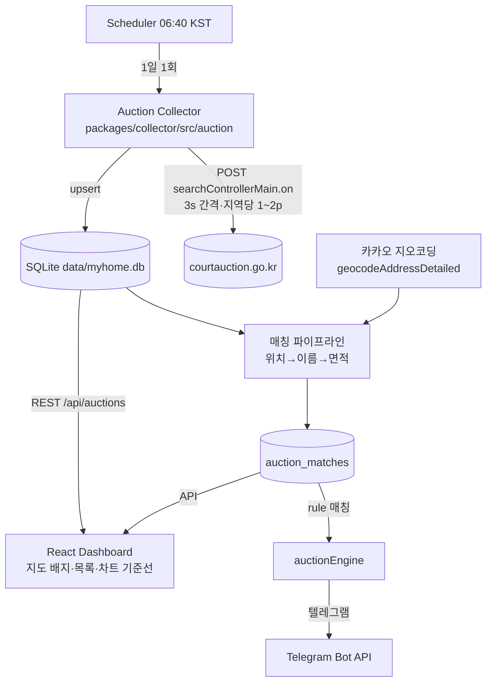

# MyHome 법원경매 연계 및 단지 매칭 개발 계획 (Phase 15)

- **작성일**: 2026-11-26
- **대상**: `packages/collector`, `packages/shared`, `packages/dashboard` (server/UI)
- **선행 검증**: `courtauction.go.kr` 물건 자유 조건검색 PoC (2026-11-26 실측, 부록 A·B)
- **목적**:
  1. 대법원 **법원경매정보**(`courtauction.go.kr`)의 진행 물건을 `myhome`의 수집 지역(`regions.lawd_code`) 중심으로 **저속 수집**해 로컬 DB에 적재한다.
  2. 경매 물건을 **단지(`complexes`)** 와 연결해 "이 단지에 경매 물건이 N건, 최저매각가 X억"을 지도·목록·상세·차트에 **오버라이드 표시**한다.
  3. 기존 룰 엔진·텔레그램 알림에 **경매 기준선(감정가/최저매각가/유찰횟수)** 조건을 연결한다.

> **결론(PoC)**: 순수 HTTP POST로 **브라우저·세션·쿠키 없이** JSON 조회가 가능하며, 수원시 영통구 아파트 8건·성남시 분당구 아파트 4건을 실제로 받아 필드 구조를 확정했다. 다만 사이트는 IP 단위 자동화 차단(약 16회/30초 → 1시간 차단) 정책이 있으므로 **저속·소량·1일 1회** 원칙을 수집기 설계에 강제한다.

---

## 1. PoC 검증 결과 (실측 스펙)

### 1.1 호출 방식 — 인증 없음

| 항목 | 실측 결과 |
|---|---|
| 엔드포인트 | `POST https://www.courtauction.go.kr/pgj/pgjsearch/searchControllerMain.on` |
| 인증/세션 | **불필요**. 웜업(`GET /pgj/index.on?w2xPath=/pgj/ui/pgj100/PGJ151F00.xml&pgjId=151F00`) 시 `WMONID`·`SID`·`cortAuctnLgnMbr`·`JSESSIONID` 쿠키가 오지만, **쿠키·Referer 없이 단발 POST만으로 HTTP 200 + 정상 JSON** 확인 |
| 필수 헤더 | `Content-Type: application/json; charset=UTF-8` + 일반 브라우저 `User-Agent` (Chrome 131 UA로 검증) |
| 권장 헤더 | `Origin`, `Referer`(위 w2xPath), `X-Requested-With: XMLHttpRequest`, `submissionid: mf_wfm_mainFrame_sbm_selectGdsDtlSrch`, `sc-userid: SYSTEM` |
| 프레임워크 | WebSquare 5 RIA — 요청 본문이 `dma_*` dataMap 2개로 중첩된 JSON |
| 응답 | `application/json;charset=UTF-8`, 표준 envelope(`status`/`message`/`timestamp`/`errors`/`data`/`token`) |

### 1.2 요청 페이로드 (47필드, 전부 string 권장)

```json
{
  "dma_pageInfo": {
    "pageNo": 1, "pageSize": 50, "bfPageNo": "", "startRowNo": "",
    "totalCnt": "", "totalYn": "Y", "groupTotalCount": ""
  },
  "dma_srchGdsDtlSrchInfo": {
    "rletDspslSpcCondCd": "", "bidDvsCd": "000331", "mvprpRletDvsCd": "00031R",
    "cortAuctnSrchCondCd": "0004601",
    "rprsAdongSdCd": "41", "rprsAdongSggCd": "117", "rprsAdongEmdCd": "",
    "rdnmSdCd": "", "rdnmSggCd": "", "rdnmNo": "",
    "mvprpDspslPlcAdongSdCd": "", "mvprpDspslPlcAdongSggCd": "", "mvprpDspslPlcAdongEmdCd": "",
    "rdDspslPlcAdongSdCd": "", "rdDspslPlcAdongSggCd": "", "rdDspslPlcAdongEmdCd": "",
    "cortOfcCd": "", "jdbnCd": "", "execrOfcDvsCd": "",
    "lclDspslGdsLstUsgCd": "20000", "mclDspslGdsLstUsgCd": "20100", "sclDspslGdsLstUsgCd": "20104",
    "cortAuctnMbrsId": "",
    "aeeEvlAmtMin": "", "aeeEvlAmtMax": "",
    "lwsDspslPrcRateMin": "", "lwsDspslPrcRateMax": "",
    "flbdNcntMin": "", "flbdNcntMax": "",
    "objctArDtsMin": "", "objctArDtsMax": "",
    "mvprpArtclKndCd": "", "mvprpArtclNm": "", "mvprpAtchmPlcTypCd": "",
    "notifyLoc": "off", "lafjOrderBy": "", "pgmId": "PGJ151F01", "csNo": "",
    "cortStDvs": "2", "statNum": 1,
    "bidBgngYmd": "20261126", "bidEndYmd": "20270228", "dspslDxdyYmd": "",
    "fstDspslHm": "", "scndDspslHm": "", "thrdDspslHm": "", "fothDspslHm": "",
    "dspslPlcNm": "", "lwsDspslPrcMin": "", "lwsDspslPrcMax": "",
    "grbxTypCd": "", "gdsVendNm": "", "fuelKndCd": "",
    "carMdyrMax": "", "carMdyrMin": "", "carMdlNm": "", "sideDvsCd": ""
  }
}
```

- `pageSize`는 사이트 드롭다운 값 **10 / 20 / 50 / 100** 만 허용(그 외 값은 HTTP 400). 50·20 실측 성공.
- 지역을 주면 `cortStDvs: "2"`(지번주소 검색), 지역 없이 매각공고 단위로 조회하면 `"1"`.
- `bidBgngYmd` ~ `bidEndYmd` = **매각기일 범위**. 비우면 사이트 기본 기간이 적용되어 최근 2주 안팎만 나온다(영통구 건물 전체 `totalCnt 52` 조회에서 수신한 50행의 기일이 2026-11-27~12-09에 몰려 있었음). **수집기는 항상 기일 범위를 명시**한다.
- 면적·감정가·최저가·유찰횟수·법원(`cortOfcCd`)·법원계(`jdbnCd`) 조건은 동일 페이로드의 해당 키로 지원된다.

### 1.3 코드 체계 (실측 확정)

| 구분 | 형식/값 | 비고 |
|---|---|---|
| 시도 | 2자리 (`41`=경기) | 표준 행정구역 코드 |
| 시군구 | **3자리** (`117`=수원시 영통구, `135`=성남시 분당구) | ⚠️ 법정동 5자리(`41117`)를 넣으면 **totalCnt 0**. `selectAdongSggLst`로 코드표 확보 가능 |
| lawd_code 변환 | `lawd_code` 5자리 = 시도2 + 시군구3 → **그대로 분해**(41117→41/117, 41135→41/135) | 응답의 `daepyoSidoCd`+`daepyoSiguCd`로 역산도 가능 |
| 용도 대분류 | `10000` 토지, `20000` 건물, `30000` 차량및운송장비, `40000` 기타 | `selectLclLst` 실측 |
| 용도 중/소분류 | `20100`/`20104` **아파트**, `20100`/`20106` 연립·다세대·빌라, `20100`/`20110` 오피스텔, `21100`/`21101`·`21111` 상가·오피스텔·근린시설 | ⚠️ `selectMclLst`/`selectSclLst`는 **빈 배열**을 반환(화면 코드표 XHR 신뢰 불가). 응답의 `dspslUsgNm` 실측값으로 코드표를 DB에 축적해야 한다 |
| 입찰 구분 | `000331` 기일입찰, `000332` 기간입찰 | `ipchalGbncd`/`bidDvsCd` |
| 물건 상태 | `mulStatcd` `01`=진행(실측), `mulJinYn` `Y` | `jinstatCd`는 상세 진행 코드(예 `0002100001`) |

### 1.4 응답 구조 및 주요 필드

```
data.dma_pageInfo{ pageNo, pageSize, startRowNo, totalCnt, groupTotalCount }
data.ipcheck              ← false면 IP 차단 신호
data.dlt_srchResult[]     ← 물건 1건 = 117컬럼
```

| 경매 필드 | 의미 | myhome 매핑 |
|---|---|---|
| `docid` | 물건 유니크 ID (`B0002502024013008779111`) | `auctions.docid` **PK** |
| `bo_cd`(`boCd`) / `sa_no` | 법원코드 / 사건번호 원본 | `auctions.bo_cd`, `sa_no` |
| `srn_sa_no` / `printCsNo` | 표시 사건번호 (`2024타경87791`) | `auctions.srn_sa_no` |
| `maemulSer` / `mokmulSer` | 매물순번 / 목적물순번 | 물건 식별 보조 |
| `jiwonNm` / `jpDeptNm` / `tel` | 법원 / 경매계 / 연락처 | 알림·상세 표시 |
| `gamevalAmt` / `minmaePrice` | 감정평가액 / 최저매각가(원) | `appraisal_amt`, `min_price` |
| `notifyMinmaePrice1` / `...Rate1` | 이번 회차 최저가 / 매각가율(%) | 최저가 검증·차트 기준선 |
| `yuchalCnt` | 유찰횟수 | 룰 조건 |
| `maeGiil` / `maeHh1` / `maePlace` | 매각기일(YYYYMMDD) / 시각(`1000`) / 장소 | `sale_date`, `sale_time`, `sale_place` |
| `mulStatcd` / `mulJinYn` / `jinstatCd` | 물건 상태 / 진행 여부 | `status_cd`, `progress_cd` |
| `lclsUtilCd`/`mclsUtilCd`/`sclsUtilCd`/`dspslUsgNm` | 용도 코드/명 | `usage_*` (아파트 판별) |
| `hjguSido`/`hjguSigu`/`hjguDong`/`daepyoLotno` | 지번주소 | `addr_*` |
| `rd1Nm`/`rd2Nm`/`rdNm`/`buldNo`/`rdAddrSub` | 도로명주소 | `addr_road_*` |
| `printSt` | 완성 주소 문자열(예 `경기도 수원시 영통구 청명로 132 323동 1층101호 (영통동,영통에듀파크)`) | 지오코딩 질의 |
| `daepyoSidoCd`/`daepyoSiguCd`/`daepyoDongCd` | 시도2/시군구3/법정동3 (`41`/`117`/`105`) | **lawd_code 구성**(41117) 및 지역 검증 |
| `buldNm` | 단지/건물명 (`영통에듀파크`) | **단지 매칭 핵심 키** |
| `buldList` | 동·층·호 (`323동 1층101호`) | 정규화 시 제거 대상 |
| `areaList` / `minArea`/`maxArea` | 전유면적 원문(`철근콘크리트조\r\n84.96㎡`) / 정수 면적 | `area_m2`, `area_key` |
| `jimokList` | 지목(토지) | 토지 물건용 |
| `pjbBuldList` / `convAddr` | 건물 표제부 요약 | 상세 표시 |
| `xCordi`/`yCordi` | 카텍(KATEC) 좌표 | ⚠️ `wgs84Xcordi/Ycordi`는 `"127"`/`"37"`로 잘려 내려와 **사용 불가** → 지오코딩 사용 |
| `groupmaemulser` / `dupSaNo` | 그룹 매물키 / 중복 사건번호 | 중복 알림 방지 |

### 1.5 PoC 실측 결과 요약 (2026-11-26, 요청 15회, 간격 3초↑, 전 회차 `ipcheck: true`)

| 조회 | 조건 | 결과 |
|---|---|---|
| 수원시 영통구 건물 전체 | 41/117, 용도 `20000`, 기일 미지정 | `totalCnt 52`, `groupTotalCount 45`, 50행 수신 |
| 수원시 영통구 아파트 | 41/117, `20000/20100/20104`, 기일 2026-11-26~2027-02-28 | **8건** |
| 성남시 분당구 아파트 | 41/135, 동일 조건 | **4건** |
| 쿠키·Referer 없는 단발 호출 | 41/117, 아파트, 기일 미지정 | HTTP 200, `totalCnt 7` |

샘플(부록 A): `2024타경87791` 영통동 957-6 「영통에듀파크」 323동 1층101호 · 감정 6.70억 / 최저 4.69억(70%) / 유찰 1회 / 기일 2026-12-02 10:00 / 전유 84.96㎡ / 수원지방법원 경매12계.

---

## 2. 수집 범위·정책 (전국 수집 아님)

1. **대상 지역**: `regions` 테이블의 `lawd_code` + 활성 `rules.region_code` + `packages/collector/config/targets.json`. (기존 `runCollector`의 대상 산출 로직을 그대로 재사용)
2. **용도**: 기본 **아파트(`20104`)**. 설정으로 `20106`(연립·다세대·빌라)·`20110`(오피스텔) 확장.
3. **기간**: 오늘 ~ **+60일** 매각기일. 페이지는 **최대 2페이지(지역당 100건)**, `pageSize=50`.
4. **호출 예산**: 지역 1개당 1~2회, **1일 총 20회 상한**. 호출 간 **3초 + 0~2초 지터**(PoC와 동일 수준).
5. **실행 주기**: **1일 1회 KST 06:40**(실거래 수집 06:00 이후, `CollectorLock`과 별도 `AuctionLock`), `system_config`의 `auction.lastSuccessDate`로 중복 차단.
6. **차단 대응**:
   - 응답 `data.ipcheck === false` → 즉시 중단, `auction.blockedUntil = now + 1h` 저장, 그 전까지 스케줄러 진입 금지.
   - HTTP 400/5xx → 1회만 30초 백오프 재시도 후 실패 기록(같은 요청 반복 금지).
   - `auction_collect_runs`에 매 실행의 요청 수·상태·차단 여부 기록, 3일 연속 실패 시 텔레그램 경고 1회.

---

## 3. 시스템 아키텍처



---

## 4. DB 스키마 확장 (`data/myhome.db`)

`packages/shared/src/db/auctions.ts` 신설(기존 모듈 규칙 준수: `initDb()`에서 DDL 실행, 하위 호환 re-export).

```sql
CREATE TABLE IF NOT EXISTS auctions (
  docid            TEXT PRIMARY KEY,
  bo_cd            TEXT NOT NULL,
  sa_no            TEXT NOT NULL,
  srn_sa_no        TEXT NOT NULL,
  maemul_ser       TEXT NOT NULL,
  mokmul_ser       TEXT NOT NULL,
  lawd_code        TEXT,                 -- daepyoSidoCd+daepyoSiguCd (예 41117)
  court_name       TEXT,                 -- jiwonNm
  dept_name        TEXT,                 -- jpDeptNm
  court_tel        TEXT,
  usage_l          TEXT, usage_m TEXT, usage_s TEXT, usage_name TEXT,
  addr_sido        TEXT, addr_sigu TEXT, addr_dong TEXT, addr_lotno TEXT,
  addr_road        TEXT, addr_buld_no TEXT, addr_full TEXT,
  buld_name        TEXT,                 -- buldNm (단지명 후보)
  dong_ho          TEXT,                 -- buldList
  area_m2          REAL, area_key INTEGER,   -- areaList 파싱, ROUND(m2*100)
  appraisal_amt    INTEGER,
  min_price        INTEGER,
  min_price_rate   REAL,
  failed_count     INTEGER,
  sale_date        TEXT,                 -- YYYY-MM-DD
  sale_time        TEXT,                 -- HH:MM
  sale_place       TEXT,
  status_cd        TEXT, progress_cd TEXT, bid_type_cd TEXT,
  raw_json         TEXT,
  first_seen_at    TEXT NOT NULL,
  last_seen_at     TEXT NOT NULL,
  closed_at        TEXT                  -- 진행 종료(매각/취하/변경) 시각
);
CREATE INDEX IF NOT EXISTS idx_auctions_lawd_sale  ON auctions(lawd_code, sale_date);
CREATE INDEX IF NOT EXISTS idx_auctions_sale_date  ON auctions(sale_date);
CREATE INDEX IF NOT EXISTS idx_auctions_status     ON auctions(status_cd, sale_date);

-- 물건 ↔ 단지 연결 (자동 매칭 + 수동 확정)
CREATE TABLE IF NOT EXISTS auction_matches (
  docid          TEXT NOT NULL,
  complex_id     TEXT NOT NULL,
  method         TEXT NOT NULL,   -- 'manual' | 'geo+name' | 'geo+name+area' | 'name+area'
  confidence     REAL NOT NULL,   -- 0~1
  distance_m     REAL,
  name_score     REAL,
  area_verified  INTEGER,         -- 1=전유면적 일치 확인
  candidates_json TEXT,           -- 상위 후보 3개 (미매핑 검토용)
  decided_by     TEXT,            -- 'auto' | 'user'
  created_at     TEXT NOT NULL,
  PRIMARY KEY (docid, complex_id)
);
CREATE INDEX IF NOT EXISTS idx_auction_matches_complex ON auction_matches(complex_id);

-- 수집 실행 이력 (차단·예산 추적)
CREATE TABLE IF NOT EXISTS auction_collect_runs (
  id TEXT PRIMARY KEY, lawd_code TEXT,
  started_at TEXT NOT NULL, ended_at TEXT,
  request_count INTEGER DEFAULT 0, http_status INTEGER,
  ipcheck INTEGER, total_cnt INTEGER, fetched INTEGER,
  matched INTEGER, unmatched INTEGER, blocked INTEGER DEFAULT 0, error TEXT
);

-- 실측 용도 코드표 (마스터 XHR이 비어 있어 응답에서 축적)
CREATE TABLE IF NOT EXISTS auction_usage_codes (
  usage_l TEXT, usage_m TEXT, usage_s TEXT, name TEXT, observed_at TEXT,
  PRIMARY KEY (usage_l, usage_m, usage_s)
);

-- 시군구 코드 캐시 (selectAdongSggLst, 월 1회 갱신)
CREATE TABLE IF NOT EXISTS auction_region_codes (
  lawd_code TEXT PRIMARY KEY, sido_cd TEXT NOT NULL, sgg_cd TEXT NOT NULL,
  display_name TEXT, verified_at TEXT
);
```

`system_config` 신규 키: `auction.enabled`, `auction.lastSuccessDate`, `auction.blockedUntil`, `auction.consecutiveFailures`.
`rules` 확장: `kind TEXT DEFAULT 'transaction'` (`'transaction' | 'auction' | 'both'`) 1컬럼 추가(기존 룰 하위 호환).

**적재 규칙**
- `docid` 기준 upsert. `sale_date`·`min_price`·`status_cd` 변화 시 `last_seen_at` 갱신, 상태가 종료(`mulJinYn != 'Y'`)면 `closed_at` 기록 후 목록에서 제외(행은 보존).
- 기본 조회는 `WHERE status_cd = '01' AND closed_at IS NULL AND sale_date >= date('now','+9 hours')` (KST 기준).

---

## 5. 3단계 단지 매칭 파이프라인

> 문제: 경매 물건의 `buldNm`(예 `힐스테이트판교엘포레에이4비엘`, `이편한세상영통2차2단지`)은 실거래 단지명(`e편한세상 영통 2차 2단지`)과 표기가 달라 1:1 매핑이 되지 않는다. → **위치 → 이름 → 면적** 3단 교차로 후보를 좁힌다.

### 5.1 1차 — 위치 매칭 (후보 압축)
1. `lawd_code`를 `daepyoSidoCd`+`daepyoSiguCd`로 확정(예 `41`+`117`=`41117`). 카카오 `searchAddresses`가 돌려주는 `lawdCode`와 다르면 **경계 단지**로 표시하고 후보군에 인접 `lawd_code`(같은 시)까지 포함.
2. 주소 질의: `printSt`(완성 주소) 우선, 실패 시 `rd1Nm rd2Nm rdNm buldNo` → 다음 `hjguSido hjguSigu hjguDong daepyoLotno`. `geocodeAddressDetailed()` 재사용(결과는 `auctions`의 지오코딩 캐시 컬럼에 저장).
3. 같은 `lawd_code` 내 `complexes.lat/lng` 중 **반경 150m**(하버사인) 후보 → 상위 5개. `idx_complexes_geocoded` 사용. 반경 내 0건이면 300m까지 1회 확장(그래도 없으면 미매핑 큐).

### 5.2 2차 — 이름 정규화·유사도
1. 정규화: 소문자화 → `아파트|APT|단지|제?N차` 등 접미 제거 → `동/층/호`·괄호·특수문자·공백 제거 → 영문/한글 변형 통일(`e편한세상 ↔ 이편한세상`, `힐스테이트 ↔ 힐스테이트`) 사전 치환.
2. `complexes_fts`(unicode61) 접두 매칭 + 토큰 자카드 유사도·정규화 레벤슈타인.
3. 점수: `name_score = max(fts_hit ? 0.7 + 0.3*sim : sim)`. 0.55 미만은 후보 유지하되 자동 확정 금지.

### 5.3 3차 — 전유면적 교차검증
1. `areaList`에서 ㎡ 추출(예 `84.96㎡` → 84.96) → `area_key = ROUND(area_m2*100)`.
2. `transactions(complex_id, area_key)` 존재 여부(±1키 허용: 84.96 vs 84.9) → `area_verified=1`.
3. `complex_area_mappings`가 있으면 공급면적↔전유면적 관계도 대조(`areaMapper` 재사용). 없으면 통과.

### 5.4 확정 규칙
| 조건 | 결과 |
|---|---|
| 후보 1개 + 100m 이내 + `name_score ≥ 0.7` | **자동 확정**(`confidence ≥ 0.85`) |
| 후보 여러 개 + 면적 일치 1개 | 자동 확정(`confirm` 0.9) |
| 이름 유사하나 면적 불일치 | `confidence ≤ 0.5`, **미매핑 큐**(자동 알림 금지·UI에 '확인 필요') |
| 후보 0건 | 미매핑 큐(`candidates_json` 비움, 사유 기록) |

- `decided_by='user'`로 확정한 매칭은 재수집 시에도 **덮어쓰지 않는다**(자동 매칭보다 우선).
- 미매핑 물건은 `auction_matches`에 넣지 않고 `candidates_json`만 남겨 관리자 화면(`/api/auctions/unmatched`)에서 확정한다.
- **`complexes`에 새 단지를 자동 생성하지 않는다**(실거래 기준 단지 목록 오염 방지).

---

## 6. 백엔드 구현

### 6.1 수집기 `packages/collector/src/auction/`
| 파일 | 역할 |
|---|---|
| `request.ts` | `buildSearchBody({lawdCode, usage, saleFrom, saleTo, pageNo, pageSize})` — lawd_code→시도/시군구 분해, 코드표 검증 |
| `client.ts` | `postSearch()` — 3초+지터, 1회 백오프 재시도, `ipcheck=false` → `BlockedError`, 예산 카운터 |
| `normalize.ts` | 117컬럼 → `AuctionRecord`(면적 파싱·날짜/시각·금액 정수화·lawd_code 구성) |
| `index.ts` | `runAuctionCollector()` — 대상 지역 산출 → 페이지 순회 → upsert → 매칭 트리거 → `auction_collect_runs` 기록 |

### 6.2 매칭 `packages/dashboard/server/auctionMatcher.ts`
- `matchAuction(docid)` / `matchPendingAuctions(limit)` — 5장 파이프라인. 지오코딩은 기존 캐시(`complexes` 좌표 + `auctions` 캐시) 우선.
- 대량 실행 시 카카오 API 호출 상한 고려: 신규 물건(수집분)만, 실행당 최대 30건.

### 6.3 스케줄러 `server/scheduler.ts`
- `AuctionLock` 클래스(CollectorLock 패턴 복제) + `runDueAuctionCollector()`.
- 진입 조건: `auction.enabled=true`, KST 06:40 이후, `auction.lastSuccessDate !== today`, `blockedUntil < now`.
- 실행 후 `batchGeocode → matchPendingAuctions(kind='auction' 룰 매칭) → sendAuctionNotifications`.

### 6.4 알림 `server/auctionEngine.ts` + `notifications.ts` 확장
- 룰 필터: `apartmentKeywords`(매칭된 `complexes.name` 기준), `minPriceEok`/`maxPriceEok`(최저매각가 억), `minArea`/`maxArea`(전유면적), 신규 조건 `maxFailedCount`(유찰횟수) — `rules`에 `max_failed_count` 선택 컬럼.
- 메시지 예시:
```
[경매 알림] 수원 영통구 아파트
지역: 수원시 영통구 / 단지: 영통에듀파크
1. 영통에듀파크 323동 1층101호 · 감정 6.70억 → 최저 4.69억(70%) · 유찰 1회 · 기일 12-02 10:00
※ 입찰 전 법원 원문 공고를 다시 확인하세요.
```
- 중복 방지 키: `auction:{docid}:{sale_date}:{min_price}` — 기일 변경·최저가 하락 시 **재알림 허용**.

---

## 7. REST API / MCP

| Method | Path | 권한 | 설명 |
|---|---|---|---|
| `GET` | `/api/auctions` | User | 지역(`lawdCode`)/단지(`complexId`)/기일 범위/상태 필터 목록 |
| `GET` | `/api/auctions/:docid` | User | 단건 상세(원문 링크·법원 연락처·기일 이력) |
| `GET` | `/api/auctions/summary` | User | 지역·단지별 진행 건수, 평균 매각가율(집계 카드용) |
| `GET` | `/api/graph/complex/:name/auctions` | User | 단지 상세용 연결 목록(차트 기준선 데이터) |
| `GET` | `/api/auctions/unmatched` | Admin | 미매핑 큐 + 후보 |
| `POST` | `/api/auctions/:docid/match` | Admin | 수동 확정(`{complexId}` → `decided_by='user'`) |
| `POST` | `/api/auction/collect` | Admin | 수동 수집 실행(예산·차단 게이트 동일 적용) |
| `GET` | `/api/auction/collect-runs` | Admin | 수집 이력·차단 상태 |

MCP(`server/mcp/manifest.ts`)에 `search_auctions`(지역·단지·기일), `get_auction_detail` 2종 추가.

---

## 8. 프론트엔드 UI (별도 최상위 메뉴 없이 기존 화면 통합)

> **원칙**: 상단/사이드 내비게이션에 별도 '경매' 메뉴를 추가하지 않고, 기존 조회 화면과 관리자 메뉴에 자연스럽게 통합한다.

| 화면 | 파일 | 변경 |
|---|---|---|
| 조회 필터 | `pages/map/` 필터 바 | **"경매 있는 단지만 보기"** 토글/필터 추가 (`hasAuction=true` 기준 지도 마커·단지 목록 동시 필터링) |
| 지도 마커 | `components/KakaoMap.tsx`, `lib/mapTheme.ts` | `createComplexMarkerHtml`의 기존 `badgeText` 옵션에 **`경매 N`** 배지(rose 톤) 표시. 배지 클릭 시 해당 단지의 경매 정보 페이지/뷰로 이동, `MapLegend`에 항목 추가 |
| 단지 목록 | `pages/map/ComplexListItem.tsx`, `ComplexListSection.tsx` | 경매 건수가 있는 단지에 **`경매 N건 · 최저 4.69억 · 12-02`** 클릭 가능한 배지 노출(거래가 대비 −% 표시). 배지 클릭 시 해당 단지의 경매 정보 페이지/뷰로 이동 |
| 단지 경매 페이지(뷰) | `pages/graph/ComplexTab/`(신규 경매 뷰 또는 `/complex/:name/auctions` 라우트) | 뱃지 클릭 시 이동하는 **단지 경매 상세 페이지**(상위 메뉴 노출 없이 딥링크/내부 이동으로만 진입). 사건번호·동/호·감정가·최저매각가(매각가율)·유찰횟수·매각기일·법원·연락처(`tel`)·원문 공고 새 창 링크 및 실거래 대비 비교 표시 |
| 실거래 차트 | `pages/graph/OverviewTab/TimeSeriesSection.tsx`, `ComplexTab/ComplexChartsSection.tsx` | `ReferenceLine` 2개(**감정가**, **최저매각가**) + 범례 토글(`ChartLegendToggles` 재사용). 단지 필터가 걸린 경우에만 노출, 툴팁에 `유찰 n회 · 기일` 표기 |
| 관리자 메뉴 | `pages/DatabaseAdmin.tsx` (기존 관리자 메뉴 내 경매 관리 섹션/탭) | 별도 메뉴 신설 없이 관리자 메뉴 안에 **경매 관리** 통합: ① 수집 상태(`auction.enabled` 토글, `blockedUntil` 차단 여부, 최근 수집 이력) 및 수동 수집 버튼(`POST /api/auction/collect`) ② 미매핑 큐 목록·후보 단지 비교·수동 매칭 확정(`POST /api/auctions/:docid/match`) |

- `AGENTS.md` 규칙대로 **한국어/영어 i18n**(`locales/ko`, `locales/en`) 동시 반영, **모바일 퍼스트(390 / 768 / 1280px)** 확인.
- 신규 타입은 `src/types.ts`의 `AuctionRecord`/`AuctionMatch`로 정의하고 server와 공유.

---

## 9. 구현 단계 (PR 단위)

### Phase 1. 수집기 + DB (자동 실행 없이 수동만)
- **대상**: `packages/shared/src/db/auctions.ts`, `packages/collector/src/auction/*`, `server/routes/auctionRoutes.ts`(`POST /api/auction/collect`), `scripts/auction-once.ts`
- **내용**: 스키마·upsert, 페이로드 빌더, 클라이언트(간격·차단 감지), 정규화, 실행 이력, 코드표 축적.
- **완료 기준**: 수동 1회 실행으로 수원시 영통구 아파트 **8건**, 성남시 분당구 **4건**이 `auctions`에 적재되고 `auction_collect_runs`에 요청 수·`ipcheck`가 남는다.

### Phase 2. 3단 매칭 파이프라인
- **대상**: `server/auctionMatcher.ts`, `packages/shared/src/db/auctions.ts`(매칭 조회/저장), 미매핑 큐 API
- **완료 기준**: PoC 샘플 12건 중 최소 8건 자동 확정(`confidence ≥ 0.85`), 나머지는 후보와 함께 미매핑 큐에 남고 오확정 0건(수동 검수).

### Phase 3. 스케줄러·알림
- **대상**: `server/scheduler.ts`, `server/auctionEngine.ts`, `server/notifications.ts`, `rules` 마이그레이션
- **완료 기준**: 06:40 1일 1회 실행·`auction.lastSuccessDate` 중복 차단·`blockedUntil` 게이트 동작, 경매 룰 1건으로 텔레그램 실수신, 동일 물건 재알림 없음(최저가 변경 시만).

### Phase 4. UI (기존 화면 및 관리자 메뉴 통합)
- **대상**: 8장 표의 파일 + `types.ts` + i18n
- **완료 기준**: 별도 최상위 '경매' 메뉴 없이 기존 조회 화면('경매만 보기' 필터, 지도/목록 경매 배지 및 클릭 시 경매 정보 페이지 이동, 차트 기준선)과 관리자 메뉴(수집 관리·미매핑 큐 수동 매칭)가 실데이터로 동작하고, 390/768/1280px 및 다크 모드에서 레이아웃 깨짐 없음.

### Phase 5. (선택) 문서·사건 상세 확장
- 사건/물건 상세(`POST /pgj/pgj15B/selectAuctnCsSrchRslt.on`)로 감정평가 요항표·기일 이력 수집.
- 매각물건명세서·감정평가서 PDF는 **매각기일 1~2주 전부터만 공개**되고 별도 insert 엔드포인트의 봇 판정이 더 엄격하므로, 실패율을 측정한 뒤 별도 트랙으로 결정한다.

---

## 10. 검증 계획

1. **단위 테스트**
   - `normalize`: PoC 원본 JSON fixture(부록 A, 2건) → 필드 매핑·면적 파싱(`84.96㎡`→84.96, `area_key` 8496)·날짜/시각 변환 검증.
   - `request`: `lawd_code`→시도/시군구 분해(41117→41/117), `pageSize` 허용값(10/20/50/100) 위반 거부, 기일 범위 포맷.
   - `client`: `ipcheck:false` → `BlockedError` + `blockedUntil` 설정, 호출 간격 준수(가짜 타이머), 400 시 1회만 재시도.
2. **매칭 테스트**: 합성 데이터(거리 80m·이름 유사 0.8·면적 일치 / 이름만 일치·면적 불일치 / 후보 0건) 3케이스.
3. **통합 테스트**: `fetch` 모킹으로 `runAuctionCollector()` → DB 적재 건수·매칭 건수·실행 이력 1행.
4. **회귀**: `npm run build`, `npm run test:shared`, `npm run test:dashboard`, `npm run check:i18n` 통과(기존 실거래·룰·차트 테스트 무변경).
5. **실데이터 리허설**: 1일 1회 실제 호출로 수원 영통구/성남 분당구 건수가 PoC 값(8·4)과 ±1 이내인지 확인, `auction_collect_runs.ipcheck` 전부 1인지 확인.

---

## 11. 리스크 및 운영 원칙

| 리스크 | 대응 |
|---|---|
| **IP 차단(1시간)** — 빠른 연속 호출 | 지역당 1~2페이지, 3초+지터(하루 20회 상한), `ipcheck:false` 즉시 중단·1시간 게이트. PoC는 15회/15분에서 차단 없음 |
| 사이트 개편(W2X 페이로드 변경) | 실패 시 `errors.errorMessage`·HTTP 코드 기록, 3일 연속 실패 시 텔레그램 1회 경고. `docs/`에 PoC 스펙 고정(본 문서 1장) |
| 코드표 미제공(`selectMclLst` 빈 배열) | `auction_usage_codes`에 실측 축적, 신규 코드 등장 시 경고 후 관리자 확인 |
| 좌표 미제공(`wgs84` 잘림) | 카카오 지오코딩 사용, 실패 주소는 `geocode_failed`로 격리(기존 정책 동일) |
| 오매칭 알림 | 자동 확정 임계값(0.85) 미달은 알림 금지·미매핑 큐. 수동 확정은 재수집에도 유지 |
| 약관/정책 | 공개 정보의 **읽기 전용** 저속 수집(개인 감시 목적), **입찰 자동화 없음**, 원문 링크 병기 및 "입찰 전 원문 재확인" 고지 |

---

## 부록 A. PoC 실측 샘플 (2026-11-26)

| 항목 | 수원 영통구 | 성남 분당구 |
|---|---|---|
| 사건번호 | `2024타경87791` (수원지방법원 경매12계) | `2026타경50908` (성남지원 경매2계) |
| 소재지 | 영통동 957-6 / 청명로 132 | 서현동 92 |
| 단지·동호 | 영통에듀파크 323동 1층101호 | 현대아파트 415동 22층2201호 |
| 감정가 / 최저가 | 670,000,000 / 469,000,000 (70%) | 2,980,000,000 / 2,980,000,000 |
| 유찰 / 기일 | 1회 / 2026-12-02 10:00 (광교신청사 제101호 법정) | 0회 / 2026-12-07 10:00 |
| 전유면적 | 84.96㎡ (area_key 8496) | 186.24㎡ (area_key 18624) |
| 용도 | `20000/20100/20104` 아파트 | 동일 |
| 좌표 | 카텍 318087/517685 (wgs84 값 잘림) | — |

응답 컬럼은 **117개**이며 `raw_json`으로 원문 보존한다.

## 부록 B. 재현 스크립트 (Node 22+)

```js
const BASE = "https://www.courtauction.go.kr";
const body = { /* 1.2 페이로드. rprsAdongSdCd:"41", rprsAdongSggCd:"117",
                  lcl/mcl/scl="20000/20100/20104",
                  bidBgngYmd:"20261126", bidEndYmd:"20270228", pageSize:50 */ };
const res = await fetch(`${BASE}/pgj/pgjsearch/searchControllerMain.on`, {
  method: "POST",
  headers: {
    "Content-Type": "application/json; charset=UTF-8",
    "User-Agent": "Mozilla/5.0 (Windows NT 10.0; Win64; x64) AppleWebKit/537.36 " +
                  "(KHTML, like Gecko) Chrome/131.0.0.0 Safari/537.36",
    Origin: BASE,
    Referer: `${BASE}/pgj/index.on?w2xPath=/pgj/ui/pgj100/PGJ151F00.xml&pgjId=151F00`,
    "X-Requested-With": "XMLHttpRequest",
    submissionid: "mf_wfm_mainFrame_sbm_selectGdsDtlSrch",
    "sc-userid": "SYSTEM",
  },
  body: JSON.stringify(body),
});
const json = await res.json();
if (json?.data?.ipcheck === false) throw new Error("BLOCKED: 1시간 대기");
console.log(json.data.dma_pageInfo.totalCnt, json.data.dlt_srchResult.length);
```

> 실행 간 **3초 이상 간격**을 반드시 둔다. 실패한 요청을 그대로 반복하지 말고 원인(`ipcheck`, HTTP 코드, `errors.errorMessage`)을 먼저 확인한다.
